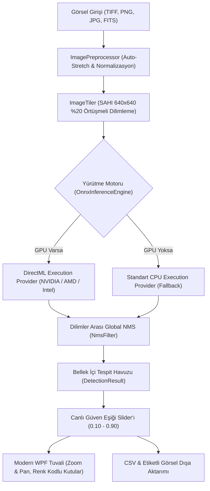

# ✦ AstroCounter

> **Astrofotoğraflarda Yapay Zeka ve Fotometri Tabanlı Nesne Tespiti ve Sayımı**  
> SAHI (Slicing Aided Hyper Inference) + YOLO11 / DirectML GPU Hızlandırma + Canlı Eşikleme (Interactive Live Filtering)

[](https://github.com/astro-counter/astro-object-counter/actions)
[](LICENSE)
[](https://dotnet.microsoft.com/)
[](https://onnxruntime.ai/)
[]()

---

## 🌟 Projeye Genel Bakış

Astrofotoğraflar genellikle 24 MP ile 50 MP+ gibi devasa çözünürlüklere sahiptir. Geleneksel yapay zeka modelleri görüntüleri küçülterek girdi aldığında sönük yıldızlar ve derin uzay cisimleri (DSO) pikseller arasında kaybolur.

**AstroCounter**, astronomi fotoğraflarını **SAHI (Slicing Aided Hyper Inference)** mimarisiyle 640×640 pencerelere bölerek mikro detayları yakalar, parça sınırlarında kalan aynı nesneleri dilimler arası **Global Non-Maximum Suppression (NMS)** ile birleştirir ve tespit edilen cisimleri bilimsel güvenilirlik aralıklarına (**Confidence Tiers / SNR**) göre anında sınıflandırıp sayar.

---

## 🚀 Öne Çıkan Özellikler

- **⚡ Sıfır Kurulum & DirectML GPU Desteği:** Kullanıcıların Python, CUDA veya cuDNN kurması gerekmez. Windows DirectML sayesinde NVIDIA, AMD ve Intel GPU'lar tak-çalıştır hızlanır; harici GPU bulunmayan cihazlarda otomatik CPU fallback çalışır.
- **🎚️ Canlı Güven Filtresi (Re-Inference Gerektirmez):** Tüm tespitler ve skorlar bellekte tutulur. Kullanıcı eşik slider'ını kaydırdığında yapay zeka tekrar çalıştırılmadan sayım ve görsel etiketler anında yenilenir.
- **🔭 3 Kademeli Güvenilirlik Havuzu (Astronomik Kova Mantığı):**
  - **Tier 1 (Yüksek Güvenilirlik - $c \ge 0.80$ veya $>10\sigma$):** Belirgin parlak yıldızlar ve net derin uzay cisimleri.
  - **Tier 2 (Orta Güvenilirlik - $0.50 \le c < 0.80$ veya $5\sigma - 10\sigma$):** Sönük yıldızlar ve arka plan gökadaları.
  - **Tier 3 (Düşük / Spekülatif - $0.25 \le c < 0.50$ veya $3\sigma - 5\sigma$):** Sensör gürültüsü sınırındaki sönük foton birikintileri.
  - **Elenen Gürültü ($c < 0.25$ veya $<3\sigma$):** Sıcak piksel ve arka plan dalgalanmaları.
- **🔍 Etkileşimli Pan & Zoom Tuvali:** Milyonlarca piksellik derin uzay fotoğraflarında fare tekerleğiyle yakınlaşma, sürükleyerek gezinme ve renk kodlu bounding box gösterimi.
- **📊 Dışa Aktarma (Export):**
  - **CSV Formatı:** `Id`, `ClassName`, `Confidence`, `Tier`, `SNR_Sigma`, koordinatlar (`X, Y, W, H, CenterX, CenterY`).
  - **Etiketli Görsel:** Renk kodlu sınır çizgileri işlenmiş yüksek çözünürlüklü PNG/JPEG çıktısı.

---

## 🏛️ Mimari Şema



---

## 📂 Dizin Yapısı

```
astro-object-counter/
├── .github/
│   ├── ISSUE_TEMPLATE/
│   │   ├── bug_report.md
│   │   └── feature_request.md
│   └── workflows/
│       ├── build-test.yml          # Her commit/PR için otomatik derleme ve xUnit testleri
│       └── release.yml             # Tag atıldığında tek parça standalone .exe çıkaran pipeline
├── assets/
│   └── sample_images/              # Test amaçlı derin uzay ve yıldız alanı görselleri
├── models/
│   └── astro_yolo11n.onnx          # ONNX formatında tespit modeli
├── scripts/
│   ├── train.py                    # Ultralytics YOLO11 eğitim scripti
│   ├── export_onnx.py              # Dynamic batching ve ONNX dönüşüm scripti
│   └── generate_sample_assets.py   # Sentetik astrofotoğraf ve model üretici
├── src/
│   ├── AstroCounter.Core/          # Tiling, ONNX DirectML ve NMS motoru (Class Library)
│   │   ├── Export/                 # ResultExporter (CSV ve görsel çıktı)
│   │   ├── Inference/              # OnnxInferenceEngine & IInferenceEngine
│   │   ├── Models/                 # AstrophotographyObject, BoundingBox, ConfidenceTier
│   │   └── Processing/             # ImageTiler, NmsFilter, ConfidenceClassifier, Preprocessor
│   ├── AstroCounter.UI/            # Modern WPF Masaüstü Arayüzü
│   │   ├── ViewModels/             # MainViewModel, RelayCommand, VisualBoxViewModel
│   │   └── MainWindow.xaml         # Zoom/Pan tuvali, canlı slider, istatistik kartları
│   └── AstroCounter.Tests/         # Tiling, NMS ve sınıflandırma birim testleri
├── .gitattributes                  # Git LFS kuralları (*.onnx, *.bin)
├── .gitignore                      # .NET, Visual Studio ve Python cache filtreleri
├── LICENSE                         # MIT Lisansı
└── README.md
```

---

## 🛠️ Hızlı Başlangıç

### 1. Gereksinimler
- Windows 10 veya Windows 11 (64-bit)
- [.NET SDK 10.0](https://dotnet.microsoft.com/) (Geliştirme için)
- Python 3.10+ (Modeli sıfırdan eğitmek isterseniz)

### 2. Projeyi Derleme ve Çalıştırma
```powershell
# Depoyu klonlayın
cd astro-object-counter

# Çözümü derleyin
dotnet build src/AstroCounter.slnx

# Birim testleri çalıştırın
dotnet test src/AstroCounter.Tests/AstroCounter.Tests.csproj

# Masaüstü uygulamasını başlatın
dotnet run --project src/AstroCounter.UI/AstroCounter.UI.csproj
```

### 3. Tek Parça Portable .EXE Olarak Paketleme (Sıfır Kurulum)
Kullanıcıların .NET SDK yüklemesine gerek kalmadan tek tıkla çalıştırabileceği bağımsız binary üretmek için:
```powershell
dotnet publish src/AstroCounter.UI/AstroCounter.UI.csproj `
  -c Release `
  -r win-x64 `
  --self-contained true `
  -p:PublishSingleFile=true `
  -p:IncludeNativeLibrariesForSelfExtract=true `
  -p:EnableCompressionInSingleFile=true `
  -o ./publish
```
Çıktı klasöründeki `AstroCounter.UI.exe` doğrudan dağıtılabilir (~75 MB).

---

## 🧠 Model Eğitimi & ONNX Export (Opsiyonel)

Kendi astrofotoğraflarınızla YOLO11 modelini eğitmek isterseniz:

```powershell
# Gerekli kütüphaneleri yükleyin
pip install ultralytics onnx

# Modeli eğitin
python scripts/train.py --data astro_data.yaml --epochs 100 --batch 16

# Modeli ONNX formatına dönüştürün
python scripts/export_onnx.py --weights runs/astro_train/astro_detector/weights/best.pt --output models/astro_yolo11n.onnx
```

---

## 📄 Lisans
Bu proje [MIT Lisansı](LICENSE) kapsamında açık kaynak olarak lisanslanmıştır.

