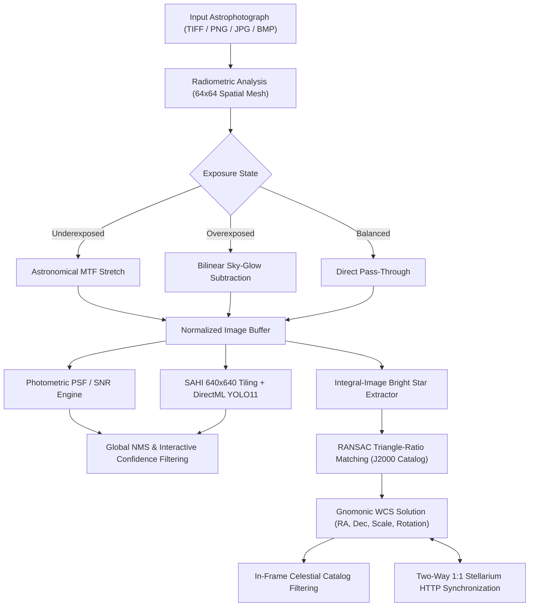

# AstroCounter v1.1.2

**Language / Dil:** **English (Default)** | [**Türkçe Dokümantasyon (TR)**](README.tr.md)

[](https://github.com/ghostkronos/AstroCounter/actions)
[](https://github.com/ghostkronos/AstroCounter/releases)
[](LICENSE)
[](https://dotnet.microsoft.com/)
[](https://onnxruntime.ai/)
[](https://stellarium.org/)

---

> [!NOTE]
> **Project Scope:**  
> AstroCounter is an open-source desktop application designed for astrophotography analysis, photometric source extraction, blind geometric plate solving, and real-time Stellarium synchronization. It ships with a baseline trained neural network model (`models/astro_yolo11n.onnx`) and an embedded J2000 reference star and deep-sky catalog. Users can also load custom-trained ONNX models directly from the interface.

---

## Overview

High-resolution astrophotography images frequently exceed 24 MP to 100 MP and exhibit extreme dynamic range variations, from severely underexposed linear stacks to frames affected by heavy urban sky glow. Standard object detection pipelines downscale full frames to small input tensors, causing faint stellar point sources and compact deep-sky objects to vanish.

**AstroCounter v1.1.2** integrates three core astrophotography processing stages into a unified Windows presentation interface:

1. **Automatic Radiometric Normalization:** Evaluates local sky background medians and stellar contrast percentiles across a 2D spatial mesh. Underexposed linear frames are stretched via an astronomical Midtone Transfer Function (MTF), while overexposed frames undergo bilinear sky-glow subtraction.
2. **Dual-Engine Source Detection:** Supports analytical point-spread-function signal-to-noise ratio photometry (DAOStarFinder standard) alongside Slicing Aided Hyper Inference (SAHI) with hardware-accelerated YOLO11 ONNX models via Windows DirectML.
3. **Blind Triangle-Pattern Plate Solving and Stellarium Synchronization:** Extracts sub-pixel stellar centroids, matches scale- and rotation-invariant triangle ratios against an embedded J2000 catalog using RANSAC, computes gnomonic tangent-plane World Coordinate System (WCS) parameters, and establishes two-way real-time viewport synchronization with Stellarium.

---

## System Architecture and Processing Workflow



---

## Key Capabilities in v1.1.2

### 1. Blind Geometric Plate Solving
* **Offline Astrometric Calibration:** Isolates bright stellar centroids using integral-image local background subtraction and suppresses nebula gradients and panorama border steps.
* **Geometric Invariants and RANSAC Verification:** Constructs scale- and rotation-invariant triangle side ratios ($a/c, b/c$), validates chirality, and refines a 2D similarity transformation on a gnomonic tangent plane. Includes bright-star concordance verification to prevent false-positive regional alignments.
* **Automatic In-Frame Catalog Scanning:** Once a valid WCS solution is established, AstroCounter scans an embedded catalog of more than 120 deep-sky objects (Messier, NGC, IC galaxies, nebulae, clusters, and navigation stars) and populates the target selector exclusively with objects located inside the photograph's field of view.

### 2. Two-Way 1:1 Stellarium Integration
* **Automated Windowed Launcher:** Clicking **Stellarium: Connect** verifies whether Stellarium is running. If closed, AstroCounter locates the local Stellarium installation, launches it in windowed mode (`-f no`), and enables the HTTP Remote Control service (`localhost:8090`) for the active session without modifying permanent Stellarium configuration files.
* **Bidirectional Viewport Locking:**
  - Panning or zooming the photograph in AstroCounter immediately updates Stellarium's equatorial coordinates and field of view.
  - Panning or zooming inside Stellarium synchronously pans, scales, and rotates the photograph in AstroCounter.
* **Spherical Coordinate Grid and Orientation Control:** Projects curved Right Ascension and Declination grid lines onto the image plane and provides a continuous $0^\circ\text{--}360^\circ$ orientation slider.

### 3. Automatic Brightness and Contrast Normalization
* **Underexposed Frame Recovery:** Applies a non-linear Midtone Transfer Function:
  $$\text{MTF}(t, m) = \frac{(m - 1)t}{(2m - 1)t - m}$$
  anchored to stellar signal percentiles so faint stars are illuminated without clipping bright cores or crushing dark sky structure.
* **Sky-Glow Suppression:** Models RGB background gradients across $64 \times 64$ cells and subtracts light pollution pedestals prior to source extraction.

### 4. Dual Detection Engine and Region-of-Interest Tools
* **Hardware Acceleration:** Executes ONNX inference on NVIDIA, AMD, and Intel GPUs via DirectML with automatic CPU fallback.
* **Lossless Scientific Format Support:** Decodes 8-bit, 16-bit integer, and 32-bit IEEE floating-point TIFF stacks (striped and tiled) alongside standard image formats.
* **Real-Time Confidence Filtering and ROI Masking:** Filters detections in memory across signal-to-noise tiers (`>10σ`, `5-10σ`, `3-5σ`, `<3σ`) and supports rectangular and polygonal inclusion/exclusion masks.

---

## Stellarium Installation and Configuration

To use two-way sky synchronization, install the Stellarium desktop application on your system.

### 1. Download and Install Stellarium
* **Official Website:** [https://stellarium.org/](https://stellarium.org/)
* **Direct Windows 64-bit Installer (GitHub Releases):** [https://github.com/Stellarium/stellarium/releases/latest](https://github.com/Stellarium/stellarium/releases/latest)

### 2. Automatic Connection (Recommended)
If Stellarium is installed in its default directory (`C:\Program Files\Stellarium`), no manual configuration is required:
1. Launch AstroCounter and click **Stellarium: Connect** on the top toolbar.
2. AstroCounter automatically starts Stellarium in windowed mode with the HTTP Remote Control endpoint enabled on port `8090` and establishes a live connection.

### 3. Manual Plugin Configuration (If Stellarium Is Already Open)
If you launch Stellarium manually prior to connecting:
1. Press **F2** in Stellarium to open the Configuration window.
2. Select the **Plugins** tab and choose **Remote Control** from the left list.
3. Enable **Load at startup**, click **Configure**, check **Server enabled** on port `8090`, and save settings.
4. Restart Stellarium and click **Stellarium: Connect** in AstroCounter.
5. Reference documentation: [Stellarium Remote Control Plugin Documentation](https://stellarium.org/doc/head/remoteControlDoc.html).

---

## Installation and Usage

### Option A: Portable Release (No Installation Required)
1. Download the `AstroCounter-v1.1.2-Portable` archive.
2. Run `AstroCounter.UI.exe` directly on Windows 10/11 x64. No Python, CUDA, or .NET runtime installation is required.

### Option B: Build from Source
Requirements: Windows 10/11 x64 and [.NET 10.0 SDK](https://dotnet.microsoft.com/download).

```powershell
# Clone the repository
git clone https://github.com/ghostkronos/AstroCounter.git
cd AstroCounter

# Run unit tests
dotnet test src/AstroCounter.slnx -c Release

# Launch the application
dotnet run --project src/AstroCounter.UI/AstroCounter.UI.csproj -c Release
```

To build a self-contained portable executable:
```powershell
dotnet publish src/AstroCounter.UI/AstroCounter.UI.csproj -c Release -r win-x64 --self-contained true -p:PublishSingleFile=true -p:IncludeNativeLibrariesForSelfExtract=true -p:EnableCompressionInSingleFile=true -o ./AstroCounter-v1.1.2-Portable
```

---

## Training and Loading a Custom YOLO ONNX Model

```bash
pip install ultralytics
yolo task=detect mode=train model=yolo11n.pt data=astro_dataset.yaml epochs=100 imgsz=640
yolo export model=runs/detect/train/weights/best.pt format=onnx imgsz=640 simplify=True
```

In AstroCounter, click **Load Model (.onnx)** on the toolbar to select your exported model, or place it at `models/astro_yolo11n.onnx`.

---

## Repository Structure

```text
AstroCounter/
├── Directory.Build.props                # Deterministic build and privacy configuration
├── models/
│   └── astro_yolo11n.onnx               # Baseline trained YOLO11 ONNX model
├── src/
│   ├── AstroCounter.slnx                # Solution file
│   ├── AstroCounter.Core/               # Core library (Photometry, SAHI, WCS, Stellarium API)
│   │   ├── Astrometry/                  # RANSAC star-pattern solver, WCS, catalog
│   │   ├── Export/                      # Annotated image and CSV exporters
│   │   ├── Inference/                   # DirectML ONNX and photometric detection engines
│   │   ├── Models/                      # Data contracts and ROI geometry
│   │   ├── Processing/                  # TIFF decoder, MTF auto-brightness, SAHI tiler
│   │   └── Stellarium/                  # Stellarium HTTP client and windowed launcher
│   ├── AstroCounter.UI/                 # WPF desktop interface (MVVM, bilingual EN/TR)
│   └── AstroCounter.Tests/              # xUnit automated test suite
├── README.md                            # English documentation (Default)
└── README.tr.md                         # Turkish documentation
```

---

## License

This project is licensed under the MIT License. See the [LICENSE](LICENSE) file for details.
