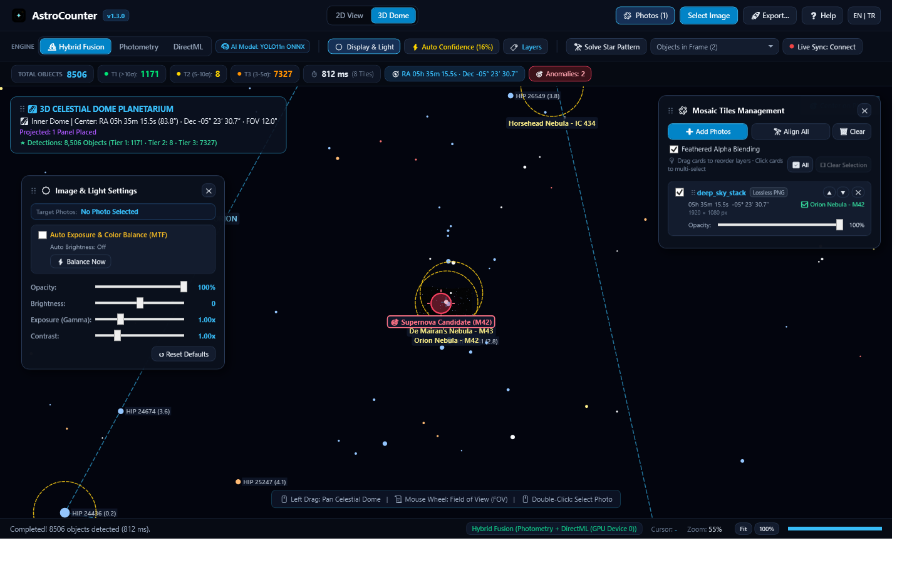
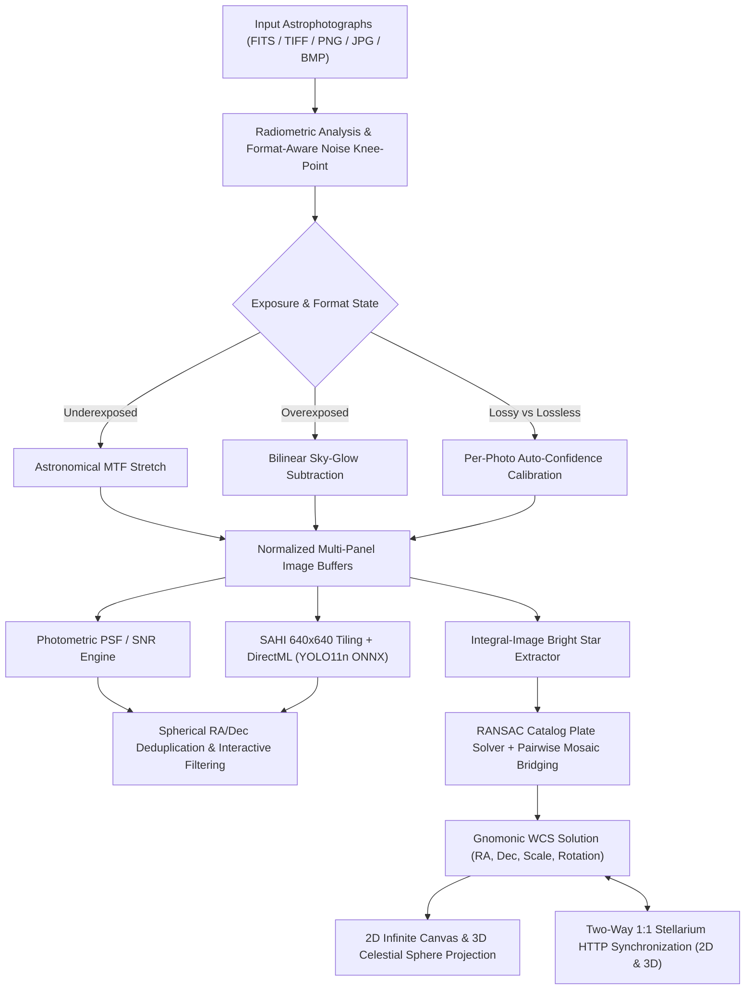
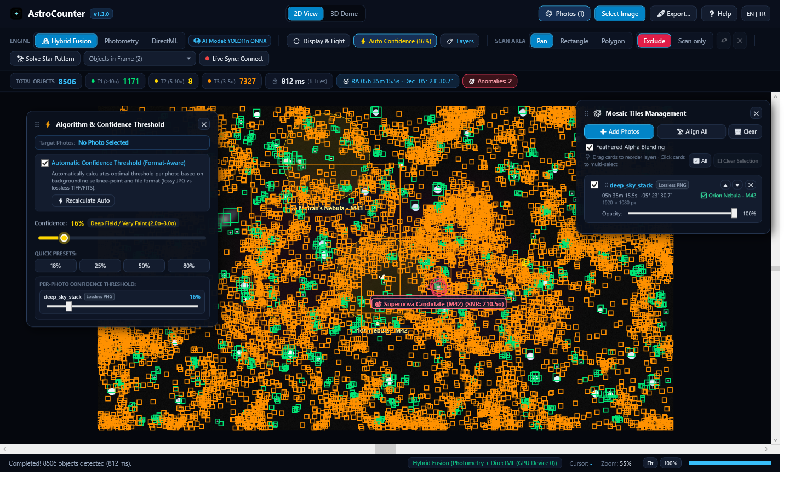
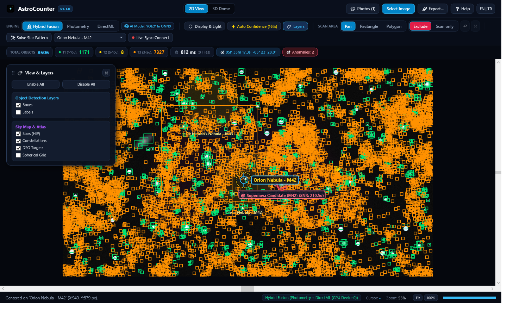
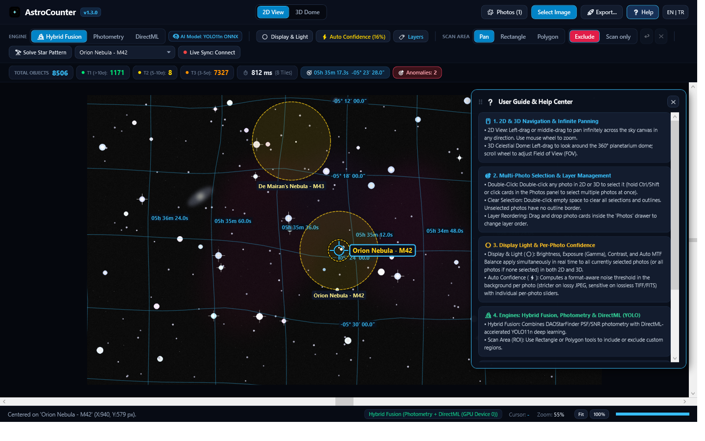
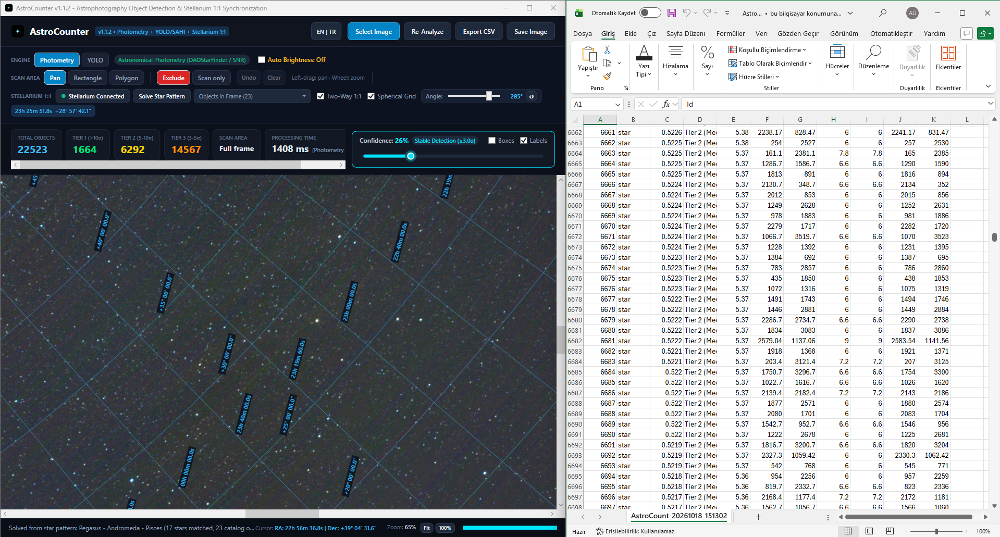

# AstroCounter v1.3.1

**Language / Dil:** **English (Default)** | [**Türkçe Dokümantasyon (TR)**](README.tr.md)

[](https://github.com/ghostkronos/AstroCounter/actions)
[](https://github.com/ghostkronos/AstroCounter/releases)
[](LICENSE)
[](https://dotnet.microsoft.com/)
[](https://onnxruntime.ai/)
[](https://stellarium.org/)

---

> [!NOTE]
> **Project Scope:**  
> AstroCounter is an open-source desktop application designed for astrophotography analysis, full-resolution photometric source extraction, multi-panel mosaic stitching, blind geometric plate solving, 3D celestial sphere visualization, and real-time Stellarium synchronization. It ships with a trained neural network model (`models/astro_yolo11n.onnx`) fine-tuned on Sloan Digital Sky Survey (SDSS DR16) astronomical cutouts, an ultra-dense **2.5 Million Gaia DR3 / Tycho-2** reference star catalog (`catalogs/gaia_tycho_dense.bin`), the complete **13,963 OpenNGC** deep-sky object catalog, and all **88 official IAU constellations**.

---

## Overview

High-resolution astrophotography frames and multi-panel sky mosaics frequently exceed 24 MP to 100 MP+ and exhibit extreme dynamic range variations—from severely underexposed linear stacks to frames affected by urban sky glow or lossy JPEG compression. Standard object detection pipelines downscale full frames into small input tensors, causing faint stellar point sources and compact deep-sky objects to vanish.

**AstroCounter v1.3.1** integrates five core astrophotography processing layers into a modern, minimalist Windows interface with movable in-app floating windows:

1. **Ultra-Dense Catalog Suite (2.5M Stars + 14K DSOs + 88 Constellations):**
   - **2,500,000 Gaia DR3 / Tycho-2 Stars** down to magnitude 14.0 for robust sub-pixel astrometric plate solving, thin-plate spline (TPS) lens distortion correction, and dense celestial background rendering.
   - **13,963 OpenNGC Deep-Sky Objects** embedded directly in the core engine (all Messier M1–M110, NGC, IC, and Caldwell objects) with automatic dynamic FOV filtering (`CataloguePlateSolver.GetTargetsInField`).
   - **All 88 Official IAU Constellations** with 695 stick-figure line segments and bilingual English/Turkish nomenclature.
2. **Multi-Engine Source Detection (`Hybrid Fusion`, `Photometry`, `DirectML`):** Combines analytical point-spread-function signal-to-noise ratio photometry (DAOStarFinder standard) with Slicing Aided Hyper Inference (SAHI) powered by a hardware-accelerated `YOLO11n ONNX` model via Windows DirectML.
3. **Format-Aware Per-Photo Auto-Confidence & Simultaneous Multi-Photo Light Processing:** Automatically computes optimal noise knee-point thresholds per photograph in the background—applying stricter filtering on lossy formats (`.jpg`/`.jpeg`) to suppress compression artifacts while preserving faint `2σ–3σ` structures on lossless scientific formats (`.tiff`, `.fits`, `.png`). Display & Light adjustments (MTF Auto-Balance, Brightness, Exposure, Contrast) apply in real time across all selected photos in both 2D and 3D views.
4. **Blind Geometric Plate Solving & Multi-Tile Mosaic Alignment:** Extracts sub-pixel stellar centroids, matches scale- and rotation-invariant geometric invariants against the dense J2000 catalog using RANSAC, bridges adjacent panels via pairwise star-correspondence homography, and deduplicates 100,000+ stars across overlapping mosaic frames in spherical sky coordinates (`RA`/`Dec`).
5. **2D Infinite Sky Canvas, 3D Planetarium Dome & 2-Way Stellarium Sync:** Provides unconstrained 2D infinite canvas panning, an interactive 360° 3D celestial dome, bidirectional real-time camera synchronization with Stellarium in both 2D and 3D modes, and 360° × 180° equirectangular panoramic exporting.



---

## System Architecture and Processing Workflow



---

## Key Capabilities in v1.3.1

### 1. Ultra-Dense Astrometric Catalogs (Gaia DR3, Tycho-2, OpenNGC & IAU 88)
* **2,500,000 Gaia DR3 / Tycho-2 Stars:** High-performance binary catalog format (`catalogs/gaia_tycho_dense.bin`, 47.7 MB) with 180 1-degree declination zones and 1 MB batch streaming. Solves wide-angle to narrow-field frames down to visual magnitude 14.0.
* **13,963 OpenNGC Deep-Sky Objects:** Embedded and compressed in core assembly (`Resources/open_ngc.catalog.gz`). Covers all 110 Messier objects, 7,840 NGC nebulae/clusters/galaxies, and 5,386 IC targets. Dynamically filters and identifies targets located inside any photographed field.
* **All 88 Official IAU Constellations:** Full 695 stick-figure segment constellation network (`Resources/constellations_88.catalog.gz`) with bilingual English and Turkish nomenclature.

### 2. Modern Minimalist UI & Movable Floating Panels
* **In-Window Draggable Tool Panels:** All utility drawers—**View & Layers (`🏷️`)**, **Display & Light (`☀️`)**, **Auto-Confidence (`⚡`)**, **Mosaic Tiles Management (`🖼️`)**, **Advanced Export (`🚀`)**, and **User Guide & Help Center (`❓`)**—are movable floating windows that can be dragged anywhere inside the workspace.
* **Multi-Photo Selection & Clean Borderless Rendering:**
  - Click photo cards in the **Photos** panel, use **All (`☑`)**, or hold `Ctrl`/`Shift` while double-clicking photos on the 2D/3D canvas to select multiple panels simultaneously.
  - Unselected photos render cleanly with **no artificial outline border**; only selected photos display an active cyan highlight border.
  - **Double-clicking empty space** in either 2D or 3D immediately clears all active selections.
* **Drag-and-Drop Layer Reordering:** Reorder overlapping mosaic panels by dragging and dropping photo cards directly inside the Photos drawer or using quick layer buttons, paired with cosine S-curve feathered alpha blending.
* **Real-Time Multi-Stage Backend Telemetry:** The status bar reports exact background operations stage by stage (`[Stage 1/3 - Astrometry]`, `[Stage 2/3 - Mosaic Alignment]`, `[Stage 3/3 - Full-Resolution Star Counting]`) so heavy multi-panel analyses remain responsive and transparent.

### 2. Dual Detection Engine (`DirectML` + `Photometry`) & SDSS-Trained `YOLO11n`
* **Toolbar Engine Selector & AI Badge:** Switch seamlessly between **Hybrid Fusion**, **Photometry**, and **DirectML** modes, backed by the embedded **`AI Model: YOLO11n ONNX`** (`models/astro_yolo11n.onnx`) trained on real Sloan Digital Sky Survey (SDSS DR16) celestial cutouts (stars, galaxies, nebulae, and transient/satellite artifacts).
* **Format-Aware Per-Photo Auto-Confidence:** Automatically calculates each photo's background noise knee-point upon import, adjusts sensitivity according to file format (lossy JPEG vs. lossless TIFF/FITS/PNG), and provides individual per-photo confidence sliders alongside global presets.
* **2D Region-of-Interest (ROI) Scan Tools:** Draw rectangular or polygonal **Include (`Scan only`)** and **Exclude** masks directly on the 2D canvas to isolate specific nebulae or mask out landscape foregrounds.

### 3. Simultaneous 2D/3D Display & Light Processing
* **Non-Linear Astronomical MTF & Manual Grading:** Adjust **Opacity**, **Brightness**, **Exposure (Gamma)**, **Contrast**, and **Auto Exposure & Color Balance (MTF)** in real time:
  $$\text{MTF}(t, m) = \frac{(m - 1)t}{(2m - 1)t - m}$$
* **Multi-Selection Synchronization:** Adjustments made in the **Display & Light (`☀️`)** panel apply simultaneously to all currently selected photos (or all loaded photos if none are explicitly selected) across both the **2D View** and the **3D Celestial Dome**.

### 4. 2D Infinite Canvas, 3D Planetarium Dome & 2-Way Stellarium Sync
* **Unconstrained 2D Infinite Panning:** Pan freely in any direction beyond photograph edges on the 2D canvas without hitting scroll boundaries, and zoom smoothly around the cursor from `5%` to `2000%`.
* **Two-Way 1:1 Stellarium Synchronization (2D & 3D):**
  - Clicking **Live Sync: Connect** automatically connects to (or launches) Stellarium with its HTTP Remote Control service on port `8090`.
  - Panning or zooming in either AstroCounter's **2D View** or **3D Celestial Dome** updates Stellarium's sky position and FOV in real time, and steering Stellarium's camera updates AstroCounter synchronously.
* **2D Mosaic & 360° Equirectangular Panoramic Export:** Export either the **2D Canvas / Mosaic** or a full **360° × 180° Equirectangular Panoramic Sky Map** (`1x` or `2x Super-Res 4K`) in `PNG`, `Lossless TIFF`, `JPG`, `CSV`, or `JSON` formats with customizable overlay layers.

---

## Screenshots and Interface Preview

### 1. High-Precision Photometric Detection, Multi-Photo Manager & Per-Photo Confidence
Sub-pixel stellar centroid extraction across signal-to-noise confidence tiers (`>10σ`, `5-10σ`, `3-5σ`) with format-aware per-photo Auto-Confidence controls and drag-and-drop mosaic layer management.


### 2. 3D Celestial Sphere Planetarium Dome & Simultaneous Display & Light Controls
Interactive 3D celestial sphere projection with Hipparcos reference stars, constellation lines, and real-time multi-photo brightness, gamma exposure, contrast, and MTF auto-balance adjustments.


### 3. In-Frame Celestial Target Selection & View Layers Control
Automatic scanning of embedded celestial catalogs filtered strictly to objects inside the camera's field of view, paired with the draggable **View & Layers** floating window.


### 4. Spherical Coordinate Grid & Interactive Help Center
Gnomonic tangent-plane World Coordinate System (WCS) solution projecting curved Right Ascension and Declination lines onto the 2D infinite canvas alongside the bilingual **User Guide & Help Center (`❓`)**.


### 5. Advanced Export: 2D Mosaic Canvas & 360° Panoramic Sky Map
Export annotated 2D mosaics or 360° × 180° equirectangular panoramic sky maps in `PNG`, `Lossless TIFF`, `JPG`, `CSV`, or `JSON` formats at `1x` or `2x (4K)` resolution.


---

## Stellarium Installation and Configuration

To use two-way sky synchronization in 2D and 3D views, install the Stellarium desktop application on your system.

### 1. Download and Install Stellarium
* **Official Website:** https://stellarium.org/
* **Direct Windows 64-bit Installer (GitHub Releases):** https://github.com/Stellarium/stellarium/releases/latest

### 2. Automatic Connection (Recommended)
If Stellarium is installed in its default directory (`C:\Program Files\Stellarium`), no manual configuration is required:
1. Launch AstroCounter and click **Live Sync: Connect** on the top toolbar.
2. AstroCounter automatically starts Stellarium in windowed mode with the HTTP Remote Control endpoint enabled on port `8090` and establishes a live two-way connection.

---

## Installation and Usage

### Option A: Portable Release (No Installation Required)
1. Extract the `AstroCounter-v1.3.1-Portable` directory.
2. Run `AstroCounter.UI.exe` directly on Windows 10/11 x64. No Python, CUDA, or separate .NET runtime installation is required.

### Option B: Build from Source
Requirements: Windows 10/11 x64 and [.NET 10.0 SDK](https://dotnet.microsoft.com/download).

```powershell
# Clone the repository
git clone https://github.com/ghostkronos/AstroCounter.git
cd AstroCounter

# Run the automated xUnit test suite
dotnet test AstroCounter.sln -c Release

# Launch the application
dotnet run --project src/AstroCounter.UI/AstroCounter.UI.csproj -c Release
```

To build a self-contained portable release:
```powershell
dotnet publish src/AstroCounter.UI/AstroCounter.UI.csproj -c Release -r win-x64 --self-contained true -p:PublishSingleFile=true -p:IncludeNativeLibrariesForSelfExtract=true -p:EnableCompressionInSingleFile=true -o ../AstroCounter-v1.3.1-Portable
```

---

## Training a Custom YOLO11 ONNX Model on SDSS Survey Cutouts

AstroCounter includes an automated dataset builder and training script (`scripts/train_real_astro_dataset.py`) that downloads real astronomical survey cutouts from the Sloan Digital Sky Survey (SDSS DR16 SkyServer) and fine-tunes `models/astro_yolo11n.onnx`:

```powershell
pip install ultralytics onnx onnxruntime requests pillow numpy
python scripts/train_real_astro_dataset.py
```

---

## Repository Structure

```text
AstroCounter/
├── Directory.Build.props                # Deterministic build configuration
├── AstroCounter.sln                     # Solution file
├── assets/                              # UI logos, icons, sample images, and documentation screenshots
│   └── screenshots/                     # Interface preview screenshots
├── catalogs/
│   └── gaia_tycho_dense.bin             # 2.5M Gaia DR3 / Tycho-2 binary star catalog (47.7 MB)
├── models/
│   └── astro_yolo11n.onnx               # SDSS DR16 fine-tuned YOLO11n ONNX model
├── scripts/
│   └── train_real_astro_dataset.py      # SDSS DR16 real astronomical dataset builder & YOLO11 trainer
├── src/
│   ├── AstroCounter.Core/               # Core library (Photometry, SAHI, WCS, Mosaic, Stellarium API)
│   │   ├── Astrometry/                  # RANSAC solver, Gaia/Tycho 2.5M, OpenNGC, 88 Constellations
│   │   ├── Export/                      # 2D Mosaic, 360° Equirectangular Panorama, CSV & JSON exporters
│   │   ├── Inference/                   # DirectML ONNX and photometric detection engines
│   │   ├── Models/                      # Data contracts and ROI geometry
│   │   ├── Processing/                  # FITS/TIFF decoders, MTF auto-brightness, SAHI tiler
│   │   ├── Resources/                   # Embedded OpenNGC & 88 IAU Constellations binary streams
│   │   └── Stellarium/                  # Stellarium HTTP client and windowed launcher
│   ├── AstroCounter.UI/                 # WPF desktop interface (MVVM, bilingual EN/TR, 2D & 3D Dome)
│   └── AstroCounter.Tests/              # xUnit automated test suite (109 tests)
├── README.md                            # English documentation (Default)
└── README.tr.md                         # Turkish documentation
```

---

## License

This project is licensed under the MIT License. See the [LICENSE](LICENSE) file for details.
