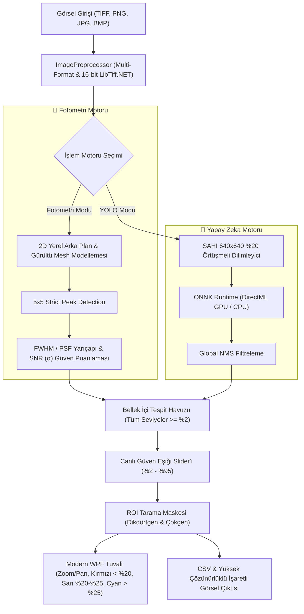

# ✦ AstroCounter

> **Astrofotoğraflarda Hibrit Yapay Zeka ve Fotometri Tabanlı Nesne Tespiti & Sayım Aracı**  
> SAHI (Slicing Aided Hyper Inference) + YOLO11 / DirectML GPU Hızlandırma + DAOStarFinder Fotometri + Dinamik Renkli Canlı Eşikleme

[](https://github.com/ghsotkronos/AstroCounter/actions)
[](LICENSE)
[](https://dotnet.microsoft.com/)
[](https://onnxruntime.ai/)
[]()
[]()

---

> [!NOTE]
> **Amatör Proje Beyanı:**  
> AstroCounter, amatör astrofotografi ve gökyüzü gözlem meraklıları için geliştirilmiş açık kaynaklı, bağımsız bir projedir. Yazılım içerisinde test ve başlangıç amaçlı **hafif düzeyde eğitilmiş bir temel yapay zeka modeli** (`models/astro_yolo11n.onnx`) yer almaktadır. Dilerseniz hiçbir kod yazmadan kendi teleskop/kamera verilerinizle eğittiğiniz özel yapay zeka modellerini sisteme tek tıkla bağlayabilirsiniz.

---

## 🌟 Projeye Genel Bakış

Astrofotoğraflar genellikle 24 MP ile 100 MP+ gibi devasa çözünürlüklere ve milyonlarca arka plan pikseline sahiptir. Klasik nesne tespit modelleri bu devasa görselleri doğrudan küçülterek analiz etmeye çalıştığında, zayıf yıldızlar, derin uzay cisimleri (DSO) ve gökadalar pikseller arasında kaybolur.

**AstroCounter**, bu sorunu çözmek için iki farklı güçlü motoru tek bir modern arayüzde birleştirir:
1. **🔭 Astronomik Fotometri Motoru:** Yapay zekaya ihtiyaç duymaksızın DAOStarFinder standardında 2D yerel arka plan mesh modellemesi, sinyal-gürültü oranı (SNR $\sigma$) ve FWHM parlaklık eğrileriyle yıldızları matematiksel olarak tespit eder.
2. **🧠 YOLO11 Derin Öğrenme Motoru (SAHI Destekli):** Görüntüyü 640×640 dilimlere bölerek en sönük cisimleri dahi yakalar, dilim sınırlarında kalan cisimleri dilimler arası **Global NMS** ile tekilleştirir.

---

## 🚀 Öne Çıkan Özellikler

* **📦 Sıfır Kurulum & Taşınabilir (Portable):** Kullanıcıların bilgisayarına Python, CUDA, cuDNN veya .NET SDK kurması gerekmez. Yayınlanan tek bir `.zip` dosyasını indirip doğrudan çalıştırabilirsiniz.
* **⚡ Windows DirectML Donanım Hızlandırma:** NVIDIA, AMD ve Intel ekran kartlarında GPU hızlandırmasıyla çalışır; harici ekran kartı bulunmayan cihazlarda otomatik olarak optimize CPU moduna geçer.
* **🖼️ Kapsamlı Stacked TIFF Desteği:** DeepSkyStacker, Siril, PixInsight gibi yazılımlardan çıkan 8-bit, 16-bit ve 32-bit (Mono/RGB, çoklu şeritli veya döşemeli) TIFF ve standart PNG, JPG, BMP formatlarını kayıpsız okur.
* **🎚️ Canlı Güven Eşiği Slider'ı (%2 - %95) ve Dinamik Renk Skalası:**  
  Yapay zekayı veya fotometriyi tekrar tekrar çalıştırmadan RAM üzerinde anlık filtreleme yapar:
  - **🔴 %20'nin Altı:** **Kırmızı** (`#EF4444`) – *"Yüksek Gürültü Riski (<2.4σ)"* rozeti ve kırmızı kutulamalar.
  - **🟡 %20 – %25 Arası:** **Sarı** (`#FFD600`) – *"Düşük Eşik (2.4σ–3.0σ)"* rozeti ve sarı kontroller.
  - **🔵 %25'in Üstü:** **Camgöbeği** (`#00E5FF`) – *"Kararlı Tespit (≥3.0σ)"* rozeti.
* **📊 Dinamik Spekülatif Sayacı:** Slider %25'in altına çekildiğinde üst panelde otomatik olarak kırmızı **SPEKÜLATİF (<3σ)** kartı belirir ve eşiğe takılan zayıf foton/gürültü sayısını anlık raporlar.
* **📐 Tarama Alanı (ROI) Araçları:**
  - **▭ Dikdörtgen** veya **⬠ Çokgen (Polygon)** çizim araçları.
  - **🚫 Hariç Tut:** Parlak komşu yıldız halelerini veya istenmeyen kenar alanlarını sayım dışı bırakır.
  - **✅ Sadece Tara:** Yalnızca seçilen bulutsu veya gökada çevresindeki yıldızları sayar.
* **💾 Dışa Aktarma (Export):**
  - **CSV Formatı:** `Id`, `ClassName`, `Confidence`, `Tier`, `SNR_Sigma`, `CenterX`, `CenterY`, `Width`, `Height` sütunlarıyla tam liste.
  - **Etiketli Görsel:** Bounding box'lar ve tarama maskeleri işlenmiş orijinal çözünürlükte PNG çıktısı.

---

## 🧠 Kendi Yapay Zekanızı Eğitme ve Entegre Etme Rehberi

AstroCounter, model bağımsız çalışacak şekilde tasarlanmıştır. İçerisindeki temel YOLO11 modelini kullanabileceğiniz gibi, kendi teleskop ve kamera donanımınıza özel bir model eğitip sisteme ekleyebilirsiniz:

### 1. Veri Seti Toplama ve Etiketleme
1. Stacklenmiş astrofotoğraflarınızı [Roboflow](https://roboflow.com/) veya [CVAT](https://www.cvat.ai/) üzerine aktarın.
2. Nesnelerinizi şu standart sınıflarla etiketleyin:
   - `star` (Normal yıldızlar)
   - `bright_star` (Kırınım dikeni/halesi olan parlak yıldızlar)
   - `galaxy` (Gökadalar)
   - `nebula` (Bulutsular)
3. Veri setinizi **YOLOv8 / YOLO11 PyTorch** formatında dışa aktarın.

### 2. Modeli Eğitme (Ultralytics)
Terminalinizde Ultralytics ile modeli eğitin:
```bash
pip install ultralytics

# Eğitim başlatın (örnek 640x640 tile boyutu)
yolo detect train data=astro_data.yaml model=yolo11n.pt epochs=60 imgsz=640 batch=16
```

### 3. ONNX Formatına Dönüştürme
Eğitim tamamlandığında ortaya çıkan `best.pt` ağırlığını dinamik batch destekli ONNX formatına çevirin:
```bash
yolo export model=runs/detect/train/weights/best.pt format=onnx imgsz=640 dynamic=True opset=17
```

### 4. AstroCounter'a Bağlama (Sıfır Kod!)
1. AstroCounter uygulamasını açın.
2. Motor seçiminden **🧠 YOLO** seçeneğini işaretleyin.
3. Yanında beliren **📂 Model Seç...** butonuna tıklayın.
4. Çıkardığınız `.onnx` dosyasını seçin.  
*(Dilerseniz dosya adını `astro_yolo11n.onnx` yapıp doğrudan uygulamanın yanındaki `models/` klasörüne de bırakabilirsiniz).*

Artık uygulama sizin eğittiğiniz özel yapay zeka modelinizle çalışacaktır!

---

## 💻 Kullanım Yöntemleri

### Yöntem A: Kurulumsuz Taşınabilir Sürüm (Tavsiye Edilen)
1. Sağ taraftaki [Releases](../../releases) bölümünden **`AstroCounter-v1.0-Windows-x64.zip`** dosyasını indirin.
2. Zip dosyasını herhangi bir klasöre çıkartın.
3. Klasör içindeki **`AstroCounter.UI.exe`** dosyasına çift tıklayarak hemen kullanmaya başlayın.

### Yöntem B: Kaynak Koddan Çalıştırma (Geliştiriciler İçin)
Gereksinimler: Windows 10/11 x64 ve [.NET SDK 10.0+](https://dotnet.microsoft.com/download).

```powershell
# Depoyu klonlayın
git clone https://github.com/KULLANICI_ADINIZ/astro-object-counter.git
cd astro-object-counter

# Testleri çalıştırın (26 birim test)
dotnet test src/AstroCounter.slnx

# Uygulamayı başlatın
dotnet run --project src/AstroCounter.UI/AstroCounter.UI.csproj
```
*(Veya ana dizindeki `AstroCounter-Baslat.bat` dosyasına çift tıklayabilirsiniz).*

---

## 🏛️ Mimari Akış Şeması



---

## 📜 Lisans

Bu proje [MIT Lisansı](LICENSE) kapsamında açık kaynak olarak yayınlanmıştır. Astronomi kulüpleri, gözlemevleri, öğrenciler ve bağımsız gökyüzü fotoğrafçıları tarafından serbestçe kullanılabilir, geliştirilebilir ve dağıtılabilir.
