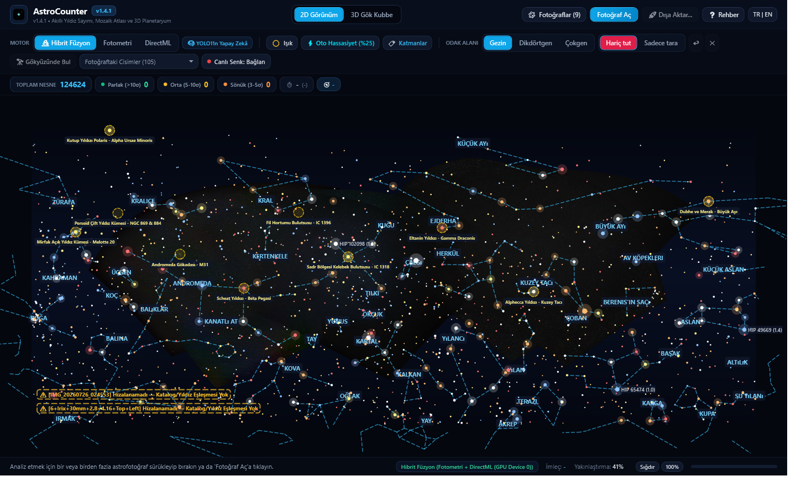
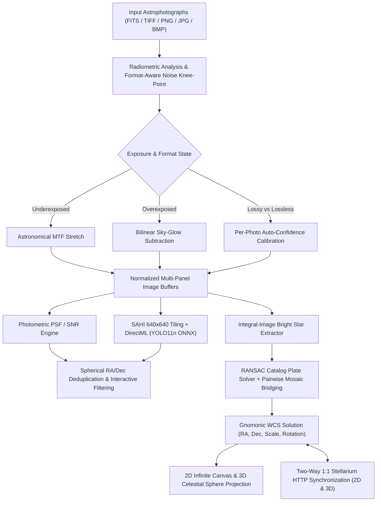
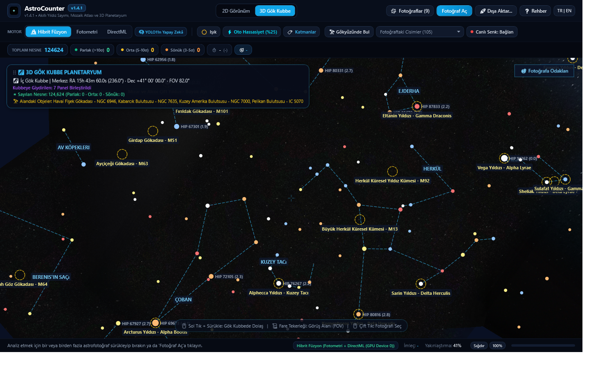
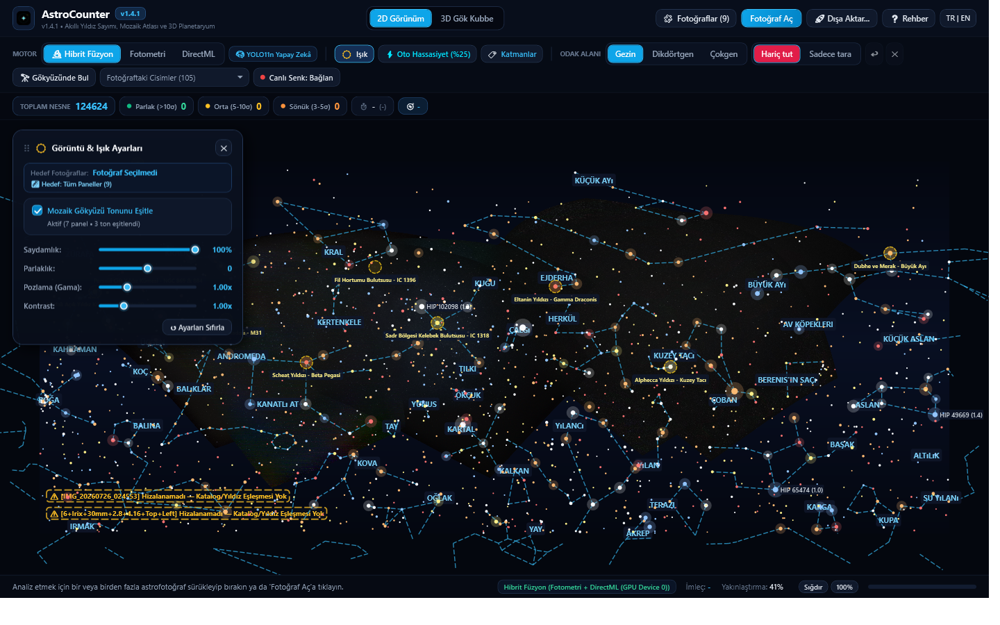
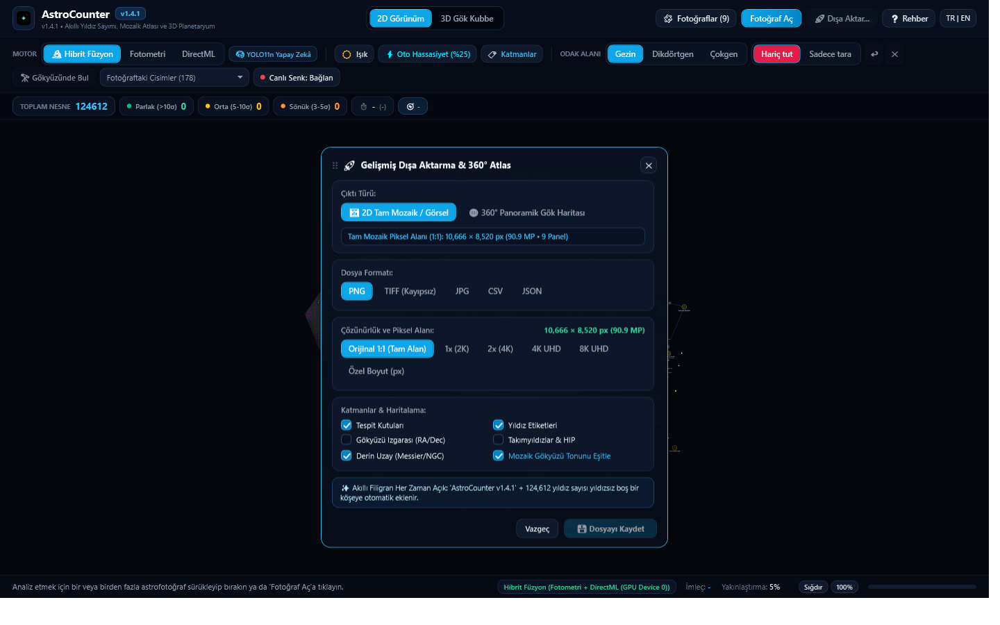
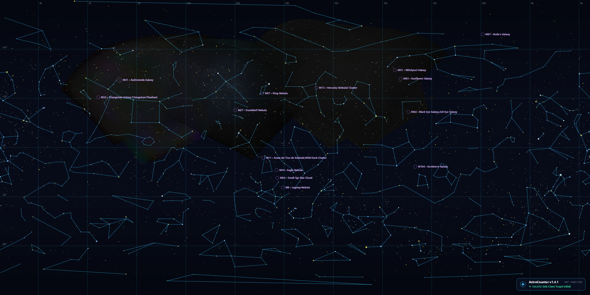

# AstroCounter v1.4.1

**Language / Dil:** **English (Default)** | [**Türkçe Dokümantasyon (TR)**](README.tr.md)

[](https://github.com/ghostkronos/AstroCounter/actions)
[](https://github.com/ghostkronos/AstroCounter/releases)
[](LICENSE)
[](https://dotnet.microsoft.com/)
[](https://onnxruntime.ai/)
[](https://stellarium.org/)

---

> [!NOTE]
> **Project Scope:**  
> AstroCounter is an open-source desktop application designed for astrophotography analysis, full-resolution photometric source extraction, multi-panel mosaic stitching, blind geometric plate solving, 3D celestial sphere visualization, and real-time Stellarium synchronization. It ships with a trained neural network model (`models/astro_yolo11n.onnx`) fine-tuned on Sloan Digital Sky Survey (SDSS DR16) astronomical cutouts, an ultra-dense **2.5 Million Gaia DR3 / Tycho-2** reference star catalog (`catalogs/gaia_tycho_dense.bin`), the complete **13,963 OpenNGC** deep-sky object catalog, and all **88 official IAU constellations**.

---

## Overview

High-resolution astrophotography frames and multi-panel sky mosaics frequently exceed 24 MP to 100 MP+ and exhibit extreme dynamic range variations—from severely underexposed linear stacks to frames affected by urban sky glow or lossy JPEG compression. Standard object detection pipelines downscale full frames into small input tensors, causing faint stellar point sources and compact deep-sky objects to vanish.

**AstroCounter v1.4.1** integrates five core astrophotography processing layers into a modern, animated **Observatory Glass** Windows interface with movable in-app floating windows:

1. **Ultra-Dense Catalog Suite (2.5M Stars + 14K DSOs + 88 Constellations):**
   - **2,500,000 Gaia DR3 / Tycho-2 Stars** down to magnitude 14.0 for robust sub-pixel astrometric plate solving, thin-plate spline (TPS) lens distortion correction, and dense celestial background rendering.
   - **13,963 OpenNGC Deep-Sky Objects** embedded directly in the core engine (all Messier M1–M110, NGC, IC, and Caldwell objects) with automatic dynamic FOV filtering (`CataloguePlateSolver.GetTargetsInField`).
   - **All 88 Official IAU Constellations** with 695 stick-figure line segments and bilingual English/Turkish nomenclature.
2. **Multi-Engine Source Detection (`Hybrid Fusion`, `Photometry`, `DirectML`):** Combines multi-scale soft-PSF signal-to-noise photometry (DAOStarFinder standard with valley-aware companion star separation) with Slicing Aided Hyper Inference (SAHI) powered by a hardware-accelerated `YOLO11n ONNX` model via Windows DirectML.
3. **Format-Aware Per-Photo Auto-Confidence & Automatic Mosaic Sky-Tone Harmonization:** Automatically computes optimal noise knee-point thresholds per photograph—suppressing compression artifacts on `.jpg`/`.jpeg` while preserving faint structures on `.tiff`/`.fits`/`.png`. Live **Mosaic Sky-Tone Harmonization** (`MosaicSkyHarmonizer`) equalizes radial gradients and sky pedestals seamlessly across both **2D** and **3D** views alongside per-panel **Display & Light** grading.
4. **Blind Geometric Plate Solving & Multi-Tile Mosaic Alignment:** Extracts sub-pixel stellar centroids, matches scale- and rotation-invariant geometric invariants against the dense J2000 catalog using RANSAC, bridges adjacent panels via pairwise star-correspondence homography, and deduplicates 100,000+ stars across overlapping mosaic frames in spherical sky coordinates (`RA`/`Dec`).
5. **Cropped Equirectangular 2D Sky Projection, 3D Planetarium Dome & 2-Way Stellarium Sync:** Renders aligned mosaics in a cropped Plate Carrée equirectangular sky projection (`2D`), an interactive 360° **3D Celestial Dome**, bidirectional real-time camera synchronization with Stellarium, and native/4K/8K/360° panoramic exports with smart empty-corner watermarking.



---

## System Architecture and Processing Workflow



---

## Key Capabilities in v1.4.1

### 1. Ultra-Dense Astrometric Catalogs (Gaia DR3, Tycho-2, OpenNGC & IAU 88)
* **2,500,000 Gaia DR3 / Tycho-2 Stars:** High-performance binary catalog format (`catalogs/gaia_tycho_dense.bin`, 47.7 MB) with 180 1-degree declination zones and 1 MB batch streaming. Solves wide-angle to narrow-field frames down to visual magnitude 14.0.
* **13,963 OpenNGC Deep-Sky Objects:** Embedded and compressed in core assembly (`Resources/open_ngc.catalog.gz`). Covers all 110 Messier objects, 7,840 NGC nebulae/clusters/galaxies, and 5,386 IC targets. Dynamically filters and identifies targets located inside any photographed field.
* **All 88 Official IAU Constellations:** Full 695 stick-figure segment constellation network (`Resources/constellations_88.catalog.gz`) with bilingual English and Turkish nomenclature.

### 2. Modern Minimalist UI & Movable Floating Panels
* **In-Window Draggable Tool Panels:** All utility drawers—**View & Layers (`🏷️`)**, **Display & Light (`☀️`)**, **Auto-Confidence (`⚡`)**, **Mosaic Tiles Management (`🖼️`)**, **Advanced Export (`🚀`)**, and **User Guide & Help Center (`❓`)**—are movable floating windows that can be dragged anywhere inside the workspace.
* **Multi-Photo Selection & Clean Borderless Rendering:**
  - Click photo cards in the **Photos** panel, use **All (`☑`)**, or hold `Ctrl`/`Shift` while double-clicking photos on the 2D/3D canvas to select multiple panels simultaneously.
  - Unselected photos render cleanly with **no artificial outline border**; only selected photos display an active cyan highlight border.
  - **Double-clicking empty space** in either 2D or 3D immediately clears all active selections.
* **Drag-and-Drop Layer Reordering:** Reorder overlapping mosaic panels by dragging and dropping photo cards directly inside the Photos drawer or using quick layer buttons, paired with cosine S-curve feathered alpha blending.
* **Real-Time Multi-Stage Backend Telemetry:** The status bar reports exact background operations stage by stage (`[Stage 1/3 - Astrometry]`, `[Stage 2/3 - Mosaic Alignment]`, `[Stage 3/3 - Full-Resolution Star Counting]`) so heavy multi-panel analyses remain responsive and transparent.

### 2. Dual Detection Engine (`DirectML` + `Photometry`) & SDSS-Trained `YOLO11n`
* **Toolbar Engine Selector & AI Badge:** Switch seamlessly between **Hybrid Fusion**, **Photometry**, and **DirectML** modes, backed by the embedded **`AI Model: YOLO11n ONNX`** (`models/astro_yolo11n.onnx`) trained on real Sloan Digital Sky Survey (SDSS DR16) celestial cutouts (stars, galaxies, nebulae, and transient/satellite artifacts).
* **Format-Aware Per-Photo Auto-Confidence:** Automatically calculates each photo's background noise knee-point upon import, adjusts sensitivity according to file format (lossy JPEG vs. lossless TIFF/FITS/PNG), and provides individual per-photo confidence sliders alongside global presets.
* **2D Region-of-Interest (ROI) Scan Tools:** Draw rectangular or polygonal **Include (`Scan only`)** and **Exclude** masks directly on the 2D canvas to isolate specific nebulae or mask out landscape foregrounds.

### 3. Simultaneous 2D/3D Sky-Tone Harmonization & Light Processing
* **Live Mosaic Sky-Tone Harmonization (`2D` & `3D`):** Enabled by default in the **Display & Light (`☀️`)** drawer (`Harmonize Mosaic Sky Tone`), sampling panel sky metrics and flattening radial sky-dome gradients seamlessly across both the **2D Equirectangular View** and the **3D Celestial Dome**.
* **Manual Per-Panel / Multi-Panel Grading:** Adjust **Opacity**, **Brightness**, **Exposure (Gamma)**, and **Contrast** on top of harmonized or raw panels across all selected photos (or all panels when none are selected) without resetting camera zoom/position.

### 4. Cropped Equirectangular 2D View, 3D Planetarium Dome & Native/360° Export
* **Cropped Plate Carrée 2D Sky Projection & Infinite Panning:** Aligned mosaic panels project onto a cropped equirectangular sky grid matching celestial geometry, with smooth cursor-centered zoom (`5%` to `2000%`) and smart overview decluttering.
* **Two-Way 1:1 Stellarium Synchronization (2D & 3D):**
  - Clicking **Live Sync: Connect** automatically connects to (or launches) Stellarium with its HTTP Remote Control service on port `8090`.
  - Panning or zooming in either AstroCounter's **2D View** or **3D Celestial Dome** updates Stellarium's sky position and FOV in real time, and steering Stellarium's camera updates AstroCounter synchronously.
* **Advanced Mosaic & 360° Panoramic Export:** Export at **Native Full Mosaic Pixel Area**, **1x**, **2x**, **4K**, **8K**, or **Custom Resolution** in `PNG`, `Lossless TIFF`, `JPG`, `CSV`, or `JSON`, with automatic **Smart Empty-Corner Watermark** (`AstroCounter v1.4.1` + object count) and a **non-blocking export progress overlay**.

---

## Screenshots and Interface Preview

### 1. Cropped Equirectangular 2D Mosaic & Sky-Tone Harmonization
Full multi-panel astrophotography mosaic (`124,624` deduplicated celestial objects) rendered onto a cropped Plate Carrée equirectangular sky grid with automatic sky-tone harmonization, 88 IAU constellations, Hipparcos reference stars, and clean unsolved-frame warnings.


### 2. 3D Celestial Dome Planetarium (Harmonized Live View)
Interactive 360° 3D celestial sphere planetarium displaying stitched, sky-tone equalized panels aligned seamlessly with Hercules (`M13`, `M92`), Corona Borealis, and Draco catalog overlays.


### 3. Integrated Display & Light Panel (`Mozaik Gökyüzü Tonu Eşitle`)
Floating **Display & Light** controls showing active target scope (`Selected Panel` vs. `All Panels`), live sky-tone equalization status (`7 panels • 3 equalized`), and non-destructive Opacity, Brightness, Exposure, and Contrast grading.


### 4. Advanced Export Configuration & Native Mosaic Area
Export modal supporting **Native Full Mosaic** (`13,775 × 7,405 px`), `1x`, `2x`, `4K`, `8K`, and **Custom Resolution** outputs across `2D Mosaic`, `360° Panorama`, `CSV`, and `JSON` with smart empty-corner watermarking.


### 5. 360° × 180° Harmonized Equirectangular Panoramic Export
Seamless 360° × 180° equirectangular sky map output with automatic radial dome flattening, clean constellation lines, and the `AstroCounter v1.4.1` smart empty-corner watermark.


---

## Stellarium Installation and Configuration

To use two-way sky synchronization in 2D and 3D views, install the Stellarium desktop application on your system.

### 1. Download and Install Stellarium
* **Official Website:** https://stellarium.org/
* **Direct Windows 64-bit Installer (GitHub Releases):** https://github.com/Stellarium/stellarium/releases/latest

### 2. Automatic Connection (Recommended)
If Stellarium is installed in its default directory (`C:\Program Files\Stellarium`), no manual configuration is required:
1. Launch AstroCounter and click **Live Sync: Connect** on the top toolbar.
2. AstroCounter automatically starts Stellarium in windowed mode with the HTTP Remote Control endpoint enabled on port `8090` and establishes a live two-way connection.

---

## Installation and Usage

### Option A: Portable Release (No Installation Required)
1. Extract the `AstroCounter-v1.4.1-portable-win-x64` directory.
2. Run `AstroCounter.UI.exe` directly on Windows 10/11 x64. No Python, CUDA, or separate .NET runtime installation is required.

### Option B: Build from Source
Requirements: Windows 10/11 x64 and [.NET 10.0 SDK](https://dotnet.microsoft.com/download).

```powershell
# Clone the repository
git clone https://github.com/ghostkronos/AstroCounter.git
cd AstroCounter

# Run the automated xUnit test suite
dotnet test src/AstroCounter.slnx -c Release

# Launch the application
dotnet run --project src/AstroCounter.UI/AstroCounter.UI.csproj -c Release
```

To build a self-contained portable release:
```powershell
dotnet publish src/AstroCounter.UI/AstroCounter.UI.csproj -c Release -r win-x64 --self-contained true -o release/AstroCounter-v1.4.1-portable-win-x64
```

---

## Training a Custom YOLO11 ONNX Model on SDSS Survey Cutouts

AstroCounter includes an automated dataset builder and training script (`scripts/train_real_astro_dataset.py`) that downloads real astronomical survey cutouts from the Sloan Digital Sky Survey (SDSS DR16 SkyServer) and fine-tunes `models/astro_yolo11n.onnx`:

```powershell
pip install ultralytics onnx onnxruntime requests pillow numpy
python scripts/train_real_astro_dataset.py
```

---

## Repository Structure

```text
AstroCounter/
├── Directory.Build.props                # Deterministic build configuration
├── assets/                              # UI logos, icons, sample images, and documentation screenshots
│   └── screenshots/                     # Interface preview screenshots
├── models/
│   └── astro_yolo11n.onnx               # SDSS DR16 fine-tuned YOLO11n ONNX model
├── scripts/                             # SDSS DR16 dataset builder & YOLO11 training scripts
├── src/
│   ├── AstroCounter.slnx                # Visual Studio / .NET solution file
│   ├── AstroCounter.Core/               # Core library (Photometry, SAHI, WCS, Mosaic, Sky Harmonizer, Stellarium API)
│   │   ├── Astrometry/                  # RANSAC solver, EquirectangularProjection, Gaia/Tycho 2.5M, OpenNGC, 88 Constellations
│   │   ├── Export/                      # Native/Custom/4K/8K Mosaic, 360° Equirectangular Panorama, Watermark, CSV & JSON exporters
│   │   ├── Inference/                   # DirectML ONNX and photometric detection engines
│   │   ├── Models/                      # Data contracts and ROI geometry
│   │   ├── Processing/                  # FITS/TIFF decoders, MosaicSkyHarmonizer, SAHI tiler
│   │   ├── Resources/                   # Embedded OpenNGC & 88 IAU Constellations binary streams
│   │   └── Stellarium/                  # Stellarium HTTP client and windowed launcher
│   ├── AstroCounter.UI/                 # WPF desktop interface (MVVM, bilingual EN/TR, 2D & 3D Dome)
│   └── AstroCounter.Tests/              # xUnit automated test suite (137 tests)
├── README.md                            # English documentation (Default)
└── README.tr.md                         # Turkish documentation
```

---

## License

This project is licensed under the MIT License. See the [LICENSE](LICENSE) file for details.
