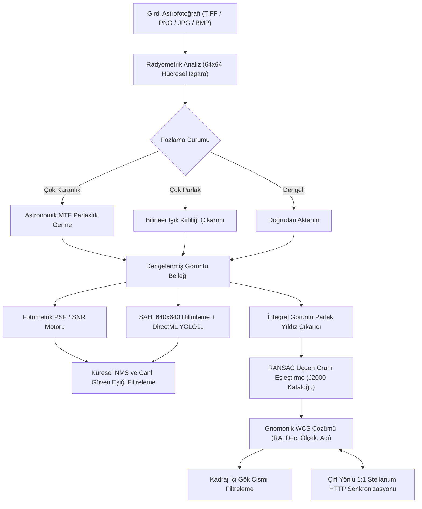

# AstroCounter v1.1.2

**Dil / Language:** [**English Documentation (EN)**](README.md) | **Türkçe (TR)**

[](https://github.com/ghostkronos/AstroCounter/actions)
[](https://github.com/ghostkronos/AstroCounter/releases)
[](LICENSE)
[](https://dotnet.microsoft.com/)
[](https://onnxruntime.ai/)
[](https://stellarium.org/)

---

> [!NOTE]
> **Proje Kapsamı:**  
> AstroCounter; astrofotoğraf analizi, fotometrik kaynak çıkarımı, kör yıldız üçgen eşleme ve gerçek zamanlı Stellarium senkronizasyonu için geliştirilmiş açık kaynaklı bir masaüstü uygulamasıdır. Yazılım, başlangıç amaçlı eğitilmiş bir sinir ağı modeli (`models/astro_yolo11n.onnx`) ve gömülü J2000 parlak yıldız ve derin uzay kataloğu ile birlikte gelir. Kullanıcılar kendi eğittikleri ONNX modellerini de doğrudan arayüz üzerinden yükleyebilirler.

---

## Genel Bakış

Yüksek çözünürlüklü astrofotoğraflar genellikle 24 MP ile 100 MP üzerinde boyuta ve çok karanlık doğrusal istiflerden yoğun şehir ışık kirliliğine kadar uzanan uç dinamik aralık farklarına sahiptir. Standart nesne tespit yöntemleri tam kare görüntüleri küçük girdi matrislerine sıkıştırdığında, sönük yıldızlar ve derin uzay cisimleri kaybolur.

**AstroCounter v1.1.2**, üç temel astronomik görüntü işleme katmanını tek bir masaüstü arayüzünde birleştirir:

1. **Otomatik Radyometrik Parlaklık Dengeleme:** İki boyutlu hücresel ızgara üzerinde yerel gökyüzü arka plan medyanını ve yıldız kontrast yüzdeliklerini analiz eder. Düşük pozlanmış karanlık görüntüleri astronomik Orta Ton Transfer Fonksiyonu (MTF) ile aydınlatır; aşırı parlak görüntülerde ise bilineer ışık kirliliği çıkarımı uygular.
2. **Çift Motorlu Kaynak Tespiti:** Analitik nokta dağılım fonksiyonu ve sinyal-gürültü oranı fotometrisini (DAOStarFinder standardı), Windows DirectML donanım hızlandırmalı 640×640 örtüşmeli dilimleme (SAHI) ve YOLO11 ONNX derin öğrenme çıkarımı ile bir arada sunar.
3. **Kör Üçgen Desenli Gökyüzü Çözümleme ve Stellarium Senkronizasyonu:** Alt-piksel hassasiyetinde yıldız merkezlerini çıkarır, ölçek ve dönüşten bağımsız üçgen kenar oranlarını RANSAC ile J2000 kataloğuna karşı doğrular, gnomonik teğet düzlem gök koordinat matrisini (WCS) hesaplar ve Stellarium ile çift yönlü gerçek zamanlı senkronizasyon kurar.


---

## Sistem Mimarisi ve İşleyiş Akışı



---

## v1.1.2 Sürümündeki Temel Özellikler

### 1. Kör Geometrik Gökyüzü Çözümleme
* **Çevrimdışı Astrometrik Kalibrasyon:** İntegral görüntü tabanlı yerel arka plan çıkarımı ile bulutsu gradyanlarını ve panorama kenar boşluklarını bastırarak parlak yıldızların ağırlık merkezlerini tespit eder.
* **Geometrik Değişmezler ve RANSAC Doğrulaması:** Ölçek ve dönüşten bağımsız üçgen kenar oranlarını ($a/c, b/c$) oluşturur, yönelim (kiralite) kontrolü yapar ve gnomonik teğet düzlem üzerinde iki boyutlu benzerlik dönüşümünü çözer. Yanlış pozitif eşleşmeleri engellemek için kadraj içi parlak yıldız tutarlılık doğrulaması içerir.
* **Otomatik Kadraj İçi Gök Cismi Tarama:** Geçerli bir WCS çözümü elde edildiğinde, gömülü katalogdaki 120'den fazla derin uzay cismi (Messier, NGC, IC gökadaları, bulutsular, yıldız kümeleri ve referans yıldızları) taranır ve hedef seçici listesine yalnızca fotoğrafın kapsama alanı içinde yer alan gök cisimleri eklenir.

### 2. Çift Yönlü 1:1 Stellarium Entegrasyonu
* **Pencereli Otomatik Başlatıcı:** **Stellarium: Bağlan** düğmesine tıklandığında Stellarium kapalıysa, uygulama yerel kurulumu bulur, geçici başlangıç betiğiyle pencereli modda (`-f no`) başlatır ve Stellarium'un kalıcı ayar dosyalarını değiştirmeden HTTP Uzaktan Kontrol servisini (`localhost:8090`) etkinleştirir.
* **Çift Yönlü Görünüm Kilitleme:**
  - AstroCounter içinde fotoğrafı kaydırdığınızda veya yakınlaştırdığınızda Stellarium anında aynı gökyüzü koordinatına ve görüş açısına odaklanır.
  - Stellarium içinde gökyüzünü gezdirdiğinizde veya yakınlaştırdığınızda fotoğraf eşzamanlı olarak aynı konuma kayar, ölçeklenir ve küresel gökyüzü açısına göre döner.
* **Küresel Koordinat Izgarası ve Yönelim Kontrolü:** Görüntü düzlemi üzerine eğrisel Sağ Açıklık ve Dik Açıklık eksenlerini çizer ve $0^\circ\text{--}360^\circ$ kesintisiz açı kontrolü sağlar.

### 3. Otomatik Parlaklık ve Kontrast Dengeleme
* **Karanlık Görüntü İyileştirme:** Yıldız sinyal yüzdeliklerine dayalı doğrusal olmayan Orta Ton Transfer Fonksiyonu uygular:
  $$\text{MTF}(t, m) = \frac{(m - 1)t}{(2m - 1)t - m}$$
  Bu sayede karanlık arka plan yapısı bozulmadan ve parlak yıldız merkezleri patlamadan sönük yıldızlar görünür hale getirilir.
* **Işık Kirliliği Bastırma:** $64 \times 64$ hücreler üzerinde RGB arka plan gradyanını modeller ve kaynak tespitinden önce şehir ışık kirliliği tabanını temizler.

### 4. Çift Tespit Motoru ve Bölgesel Tarama Araçları
* **Donanım Hızlandırma:** DirectML aracılığıyla NVIDIA, AMD ve Intel ekran kartlarında ONNX çıkarımı çalıştırır; uygun GPU bulunmadığında otomatik olarak işlemci (CPU) moduna geçer.
* **Kayıpsız Bilimsel Format Desteği:** Standart görsel formatlarının yanı sıra 8-bit, 16-bit tam sayı ve 32-bit IEEE kayan noktalı TIFF istiflerini (şeritli ve döşemeli) doğrudan okur.
* **Canlı Eşik Filtreleme ve Alan Maskeleme:** Tespit edilen nesneleri sinyal-gürültü katmanlarına (`>10σ`, `5-10σ`, `3-5σ`, `<3σ`) göre bellek üzerinde anlık filtreler; dikdörtgen ve çokgen dahil etme veya hariç tutma maskelerini destekler.

---

## Ekran Görüntüleri ve Arayüz Önizlemesi

### 1. Çift Yönlü 1:1 Stellarium Senkronizasyonu
AstroCounter ve Stellarium arasında gerçek zamanlı çift yönlü bakış açısı senkronizasyonu, küresel gök koordinat ızgarası ve yönelim açısı denetimi.


### 2. Kör Geometrik Gökyüzü Çözümleme ve Küresel Izgara İzdüşümü
Gnomonik teğet düzlem Dünya Koordinat Sistemi (WCS) çözümü ile fotoğraf düzlemine izdüşürülen eğrisel Sağ Açıklık ve Dik Açıklık eksenleri.


### 3. Kadraj İçi Gök Cismi Seçimi ve Otomatik Odaklanma
Yalnızca fotoğrafın görüş açısı içinde kalan Messier, NGC ve IC gök cisimlerinin otomatik taranması, hedef seçici ve tek tıkla hedef merkezleme.


### 4. Yüksek Hassasiyetli Fotometrik Yıldız Tespiti ve Alan Maskeleme
Sinyal-gürültü oranına (SNR) dayalı katmanlı yıldız çıkarımı (`>10σ`, `5-10σ`, `3-5σ`), çokgen hariç tutma maskeleri ve otomatik gök ışıması bastırma.


### 5. Bilimsel Veri Analizi ve CSV Dışa Aktarımı
Tespit edilen tüm gök cisimlerinin astrometrik parametreleriyle (kimlik, sınıf, güven skoru, SNR, piksel koordinatları, genişlik, yükseklik, RA, Dec) tablosal analiz ve bilimsel işleme için CSV formatında dışa aktarımı.


---

## Stellarium Kurulumu ve Yapılandırma

Çift yönlü gökyüzü senkronizasyonunu kullanmak için bilgisayarınızda Stellarium masaüstü uygulamasının kurulu olması yeterlidir.

### 1. Stellarium İndirme ve Kurulum
* **Resmi Web Sitesi:** [https://stellarium.org/](https://stellarium.org/)
* **Doğrudan Windows 64-bit Kurulum Paketi (GitHub Releases):** [https://github.com/Stellarium/stellarium/releases/latest](https://github.com/Stellarium/stellarium/releases/latest)

### 2. Otomatik Bağlantı (Önerilen)
Stellarium varsayılan dizinine (`C:\Program Files\Stellarium`) kuruluysa ek bir yapılandırma gerekmez:
1. AstroCounter'ı çalıştırın ve üst araç çubuğundaki **Stellarium: Bağlan** düğmesine tıklayın.
2. AstroCounter, Stellarium'u pencereli modda ve `8090` portunda HTTP Uzaktan Kontrol servisi açık olarak otomatik başlatır ve bağlantıyı kurar.

### 3. Manuel Eklenti Yapılandırması (Stellarium Önceden Açıksa)
Stellarium'u bağlantıdan önce kendiniz başlattıysanız:
1. Stellarium içinde **F2** tuşuna basarak Yapılandırma penceresini açın.
2. **Eklentiler** sekmesine geçin ve sol listeden **Uzaktan Kontrol** eklentisini seçin.
3. **Başlangıçta yükle** seçeneğini işaretleyin, **Yapılandır** düğmesine tıklayın, **Sunucu etkin** kutucuğunu işaretleyip port numarasını `8090` olarak kaydedin.
4. Stellarium'u yeniden başlatıp AstroCounter üzerinden **Stellarium: Bağlan** düğmesine tıklayın.
5. Teknik referans: [Stellarium Uzaktan Kontrol Eklentisi Dokümantasyonu](https://stellarium.org/doc/head/remoteControlDoc.html).

---

## Kurulum ve Kullanım

### Seçenek A: Kurulumsuz Taşınabilir Sürüm (Portable v1.1.2)
1. `AstroCounter-v1.1.2-Portable` arşivini indirin ve çıkartın.
2. `AstroCounter.UI.exe` dosyasını doğrudan çalıştırın. Python, CUDA veya .NET çalışma zamanı kurulumu gerektirmez.

### Seçenek B: Kaynak Koddan Derleme
Gereksinimler: Windows 10/11 x64 ve [.NET 10.0 SDK](https://dotnet.microsoft.com/download).

```powershell
# Depoyu klonlayın
git clone https://github.com/ghostkronos/AstroCounter.git
cd AstroCounter

# Birim testleri çalıştırın
dotnet test src/AstroCounter.slnx -c Release

# Uygulamayı başlatın
dotnet run --project src/AstroCounter.UI/AstroCounter.UI.csproj -c Release
```

Bağımsız taşınabilir çalıştırılabilir dosya üretmek için:
```powershell
dotnet publish src/AstroCounter.UI/AstroCounter.UI.csproj -c Release -r win-x64 --self-contained true -p:PublishSingleFile=true -p:IncludeNativeLibrariesForSelfExtract=true -p:EnableCompressionInSingleFile=true -o ./AstroCounter-v1.1.2-Portable
```

---

## Özel YOLO ONNX Modeli Eğitme ve Yükleme

```bash
pip install ultralytics
yolo task=detect mode=train model=yolo11n.pt data=astro_dataset.yaml epochs=100 imgsz=640
yolo export model=runs/detect/train/weights/best.pt format=onnx imgsz=640 simplify=True
```

Dışa aktardığınız modeli AstroCounter üst çubuğundaki **Model Yükle (.onnx)** düğmesiyle seçebilir veya `models/astro_yolo11n.onnx` konumuna yerleştirebilirsiniz.

---

## Proje Dizin Yapısı

```text
AstroCounter/
├── Directory.Build.props                # Deterministik derleme ve gizlilik yapılandırması
├── assets/                              # Arayüz logoları, simgeler, örnek veriler ve dokümantasyon ekran görüntüleri
│   └── screenshots/                     # Arayüz önizleme ekran görüntüleri
├── models/
│   └── astro_yolo11n.onnx               # Eğitilmiş temel YOLO11 ONNX modeli
├── src/
│   ├── AstroCounter.slnx                # Çözüm dosyası
│   ├── AstroCounter.Core/               # Çekirdek kütüphane (Fotometri, SAHI, WCS, Stellarium API)
│   │   ├── Astrometry/                  # RANSAC yıldız üçgen çözücü, WCS, katalog
│   │   ├── Export/                      # İşaretli görsel ve CSV dışa aktarıcılar
│   │   ├── Inference/                   # DirectML ONNX ve fotometrik tespit motorları
│   │   ├── Models/                      # Veri modelleri ve bölge geometrisi
│   │   ├── Processing/                  # TIFF çözücü, MTF parlaklık dengeleme, SAHI dilimleyici
│   │   └── Stellarium/                  # Stellarium HTTP istemcisi ve pencereli başlatıcı
│   ├── AstroCounter.UI/                 # WPF masaüstü arayüzü (MVVM, çift dilli EN/TR)
│   └── AstroCounter.Tests/              # xUnit otomatik birim testleri
├── README.md                            # İngilizce dokümantasyon (Varsayılan)
└── README.tr.md                         # Türkçe dokümantasyon
```

---

## Lisans

Bu proje MIT Lisansı altında lisanslanmıştır. Ayrıntılar için [LICENSE](LICENSE) dosyasına bakabilirsiniz.

