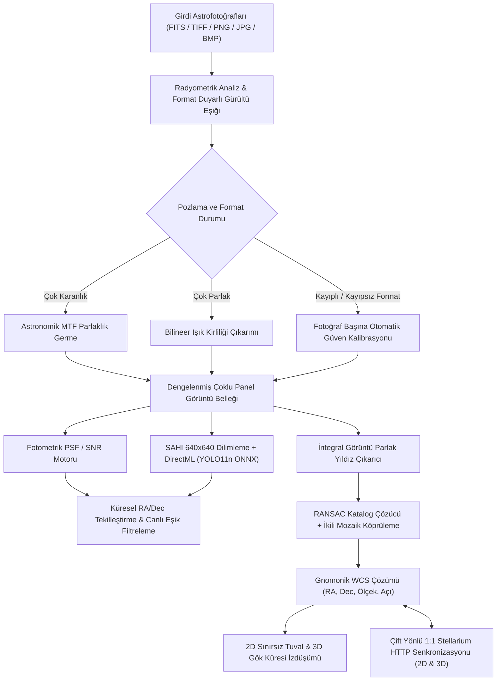

# AstroCounter v1.3.1

**Dil / Language:** [**English Documentation (EN)**](README.md) | **Türkçe (TR)**

[](https://github.com/ghostkronos/AstroCounter/actions)
[](https://github.com/ghostkronos/AstroCounter/releases)
[](LICENSE)
[](https://dotnet.microsoft.com/)
[](https://onnxruntime.ai/)
[](https://stellarium.org/)

---

> [!NOTE]
> **Proje Kapsamı:**  
> AstroCounter; yüksek çözünürlüklü astrofotoğraf analizi, tam çözünürlüklü fotometrik yıldız sayımı, çoklu mozaik kenetleme, kör geometrik gökyüzü çözümleme (plate solving), 3B gök küresi (planetarium) görselleştirmesi ve gerçek zamanlı Stellarium senkronizasyonu için geliştirilmiş açık kaynaklı bir masaüstü uygulamasıdır. Yazılım, Sloan Digital Sky Survey (SDSS DR16) gerçek gökyüzü gözlem verileriyle eğitilmiş `YOLO11n ONNX` sinir ağı modeli (`models/astro_yolo11n.onnx`), 2,5 Milyon yıldızlı yoğun **Gaia DR3 / Tycho-2** referans kataloğu (`catalogs/gaia_tycho_dense.bin`), 13.963 derin uzay cismini kapsayan **OpenNGC** kataloğu ve 88 resmi IAU takımyıldızının tamamıyla birlikte gelir.

---

## Genel Bakış

Yüksek çözünürlüklü astrofotoğraflar ve çok parçalı gökyüzü mozaikleri genellikle 24 MP ile 100 MP+ üzerinde boyuta ve çok karanlık doğrusal istiflerden yoğun şehir ışık kirliliğine veya kayıplı JPEG sıkıştırma izlerine kadar uzanan uç dinamik aralık farklarına sahiptir. Standart nesne tespit yöntemleri tam kare görüntüleri küçük girdi matrislerine sıkıştırdığında, sönük yıldızlar ve derin uzay cisimleri kaybolur.

**AstroCounter v1.3.1**, beş temel astronomik görüntü işleme katmanını pencere içinde serbestçe sürüklenebilen modern ve minimalist bir masaüstü arayüzünde birleştirir:

1. **Yoğun Gökyüzü Katalog Paketi (2.5M Yıldız + 14K DSO + 88 Takımyıldız):**
   - **2.500.000 Gaia DR3 / Tycho-2 Referans Yıldızı:** 14.0 kadir parlaklığına kadar inen ikili katalog (`catalogs/gaia_tycho_dense.bin`), 180 deklinasyon şeridi ve hızlı 1 MB akış okuyucusuyla geniş açıdan dar açıya tüm fotoğrafları çözer.
   - **13.963 OpenNGC Derin Uzay Cismi:** Çekirdeğe gömülü sıkıştırılmış veri akışı (`Resources/open_ngc.catalog.gz`) ile tüm 110 Messier nesnesi, 7.840 NGC ve 5.386 IC nesnesini kapsar; kadraj içine düşen gök cisimlerini otomatik tespit eder.
   - **88 Resmi IAU Takımyıldızı:** 695 çizgi segmentinden oluşan tam takımyıldız ağı (`Resources/constellations_88.catalog.gz`) ve çift dilli (Türkçe/İngilizce) isim desteği.
2. **Çoklu Tespit Motoru (`Hibrit Füzyon`, `Fotometri`, `DirectML`):** Analitik nokta dağılım fonksiyonu ve sinyal-gürültü oranı fotometrisini (DAOStarFinder standardı), Windows DirectML donanım hızlandırmalı 640×640 örtüşmeli dilimleme (SAHI) ve `YOLO11n ONNX` derin öğrenme çıkarımı ile bir arada sunar.
3. **Format Duyarlı Fotoğraf Başına Otomatik Güven Eşiği & Çoklu Işık İşleme:** Her fotoğrafın arka plan gürültü dirsek noktasını ve dosya formatını analiz ederek kayıplı formatlarda (`.jpg`/`.jpeg`) sıkıştırma artefaktlarına karşı daha seçici, kayıpsız bilimsel formatlarda (`.tiff`, `.fits`, `.png`) ise sönük yıldızlara karşı daha hassas eşik değerini otomatik belirler. **Görüntü & Işık (`☀️`)** panelindeki ayarlar hem 2D hem 3D ekranda seçili tüm fotoğraflara eşzamanlı olarak uygulanır.
4. **Kör Geometrik Gökyüzü Çözümleme & Çoklu Mozaik Kenetleme:** Alt-piksel hassasiyetinde yıldız merkezlerini çıkarır, ölçek ve dönüşten bağımsız üçgen kenar oranlarını RANSAC ile J2000 kataloğuna karşı doğrular, örtüşen mozaik karelerini yıldız eşleşmeleriyle birbirine kenetler ve küresel gök koordinatlarında (`RA`/`Dec`) 100.000+ yıldızı mükerrer sayım olmadan birleştirir.
5. **2D Sınırsız Tuval, 3D Gök Küresi & Çift Yönlü Stellarium Senkronizasyonu:** 2D ekranda fotoğraf sınırlarına takılmadan her yöne sınırsız kaydırma (infinite panning), 360° etkileşimli 3D gök küresi, hem 2D hem 3D modda Stellarium ile çift yönlü canlı kamera senkronizasyonu ve 360° × 180° panoramik gökyüzü haritası dışa aktarımı sunar.


---

## Sistem Mimarisi ve İşleyiş Akışı



---

## v1.3.1 Sürümündeki Temel Özellikler

### 1. Yoğun Astrometrik Katalog Paketi (Gaia DR3, Tycho-2, OpenNGC ve IAU 88)
* **2.500.000 Gaia DR3 / Tycho-2 Yıldızı:** Yüksek performanslı ikili katalog biçimi (`catalogs/gaia_tycho_dense.bin`, 47.7 MB), 180 deklinasyon şeridi ve 1 MB toplu bellek akışı ile 14.0 kadire kadar yıldızları çözer.
* **13.963 OpenNGC Derin Uzay Cismi:** Çekirdeğe gömülü sıkıştırılmış veri akışı (`Resources/open_ngc.catalog.gz`) ile 110 Messier nesnesi, 7.840 NGC bulutsu/galaksi/küme ve 5.386 IC hedefini kapsar; kadraj içine düşen nesneleri anında filtreler.
* **88 Resmi IAU Takımyıldızının Tamamı:** 695 çizgi segmentinden oluşan tam takımyıldız ağı (`Resources/constellations_88.catalog.gz`) ve Türkçe/İngilizce isim desteği.

### 2. Modern Minimalist Arayüz & Sürüklenebilir Yüzer Pencereler
* **Pencere İçi Taşınabilir Araç Panelleri:** **Katmanlar (`🏷️`)**, **Görüntü & Işık (`☀️`)**, **Otomatik Güven (`⚡`)**, **Mozaik & Fotoğraf Yöneticisi (`🖼️`)**, **Gelişmiş Dışa Aktarım (`🚀`)** ve **Kullanım Kılavuzu & Yardım Merkezi (`❓`)** pencerelerinin tamamı başlık çubuklarından tutularak çalışma alanı içinde istenilen yere sürüklenebilir.
* **Çoklu Fotoğraf Seçimi & Seçimsiz Temiz Görünüm:**
  - **Fotoğraflar** panelindeki kartlara tıklayarak, **`☑ Tümü`** düğmesini kullanarak veya 2D/3D ekranda `Ctrl`/`Shift` basılı tutup fotoğraflara çift tıklayarak birden fazla fotoğrafı aynı anda seçebilirsiniz.
  - Hiçbir fotoğraf seçili değilken fotoğrafların etrafında **herhangi bir dış çerçeve çizgisi (outline) çizilmez**; yalnızca seçilen fotoğraflar turkuaz çerçeve ile vurgulanır.
  - 2D veya 3D ekranda **boşluğa çift tıklandığında** tüm seçimler anında sıfırlanır.
* **Sürükle-Bırak Katman Sıralama:** Fotoğraflar panelindeki kartları doğrudan fareyle sürükleyip bırakarak (veya aşağı/yukarı butonlarıyla) üst üste binen mozaik karelerinin katman sırasını değiştirebilir ve kosinüs S-eğrisi yumuşak kenar geçişi (`Feathered Alpha Blending`) ile dikiş izlerini yok edebilirsiniz.
* **Aşama Aşama Canlı Backend Durum Bildirimi:** İlk fotoğraflar yüklendiğinde ve binlerce yıldız sayılırken alt durum çubuğunda arka planda yürütülen işlem aşama aşama (`[Aşama 1/3 - Astrometri]`, `[Aşama 2/3 - Mozaik Kenetleme]`, `[Aşama 3/3 - Yıldız Sayımı: Tam çözünürlükte sayılıyor...]`) canlı olarak gösterilir.

### 2. Çoklu Tespit Motoru (`DirectML` + `Fotometri`) & SDSS Eğitilmiş `YOLO11n`
* **DirectML Motor Seçici & Yapay Zekâ Model Rozeti:** Üst araç çubuğundan **Hibrit Füzyon**, **Fotometri** ve **DirectML** modları arasında anında geçiş yapılabilir; yanında aktif **`🧠 Yapay Zekâ Modeli: YOLO11n ONNX`** rozeti yer alır.
* **Format Duyarlı Fotoğraf Başına Otomatik Güven (Auto-Confidence):** Arka planda her fotoğrafın dosya formatını (`.jpg` kayıplı sıkıştırma vs. `.tiff`/`.fits`/`.png` kayıpsız) ve arka plan gürültüsünü analiz ederek fotoğraf başına en uygun güven eşiğini otomatik atar; kullanıcı **Otomatik Güven (`⚡`)** panelinden her fotoğrafın eşiğini tek tek sürgüyle de değiştirebilir.
* **2D Bölgesel Tarama Alanı (ROI) Araçları:** 2D ekranda **Dikdörtgen** veya **Çokgen** araçlarıyla belirli bir alanı **Sadece Tara** veya **Hariç Tut** maskesi olarak çizebilirsiniz.

### 3. 2D ve 3D Ekranda Eşzamanlı Çoklu Fotoğraf Işık Ayarları
* **Astronomik MTF ve Manuel Pozlama Kontrolü:** **Opaklık**, **Parlaklık**, **Pozlama (Gama)**, **Kontrast** ve **Otomatik Pozlama & Renk Dengesi (MTF)** ayarları gerçek zamanlı olarak uygulanır:
  $$\text{MTF}(t, m) = \frac{(m - 1)t}{(2m - 1)t - m}$$
* **Seçili Fotoğraflara Eşzamanlı Uygulama:** **Görüntü & Işık (`☀️`)** panelindeki tüm ayarlar hem **2D Görünüm** hem de **3D Küre** ekranında o anda seçili olan tüm fotoğraflara (hiç seçim yoksa tüm fotoğraflara) aynı anda uygulanır.

### 4. 2D Sınırsız Kaydırma, 3D Gök Küresi & Çift Yönlü Stellarium Senkronizasyonu
* **2D Sınırsız Kaydırma (Infinite Panning):** 2D ekranda fotoğrafların kenar sınırlarına takılmadan her yöne sınırsız kaydırma yapabilir ve fare tekerleğiyle imleç merkezli yakınlaştırma (`%5` – `%2000`) uygulayabilirsiniz.
* **2D ve 3D Ekranda Çift Yönlü 1:1 Stellarium Senkronizasyonu:**
  - **Canlı Senkron: Bağlan** düğmesi yerel Stellarium kurulumunu HTTP Uzaktan Kontrol servisi (`localhost:8090`) açık olarak otomatik başlatır ve bağlanır.
  - Hem **2D Görünüm** hem de **3D Küre** modunda kamerayı çevirdiğinizde veya yakınlaştırdığınızda Stellarium anında aynı gök koordinatına odaklanır; Stellarium içinde gezinildiğinde de AstroCounter senkronize olarak hareket eder.
* **2D Mozaik & 360° Panoramik Dışa Aktarım (`Export`):** **Dışa Aktar (`🚀`)** panelinden **2D Tuval / Mozaik** veya **360° × 180° Panoramik Gökyüzü Haritası (Equirectangular)** çıktısını `PNG`, `Kayıpsız TIFF`, `JPG`, `CSV` veya `JSON` formatlarında (`1x` veya `2x Süper Çözünürlük / 4K`) kaydedebilirsiniz.

---

## Ekran Görüntüleri ve Arayüz Önizlemesi

### 1. Yüksek Hassasiyetli Fotometrik Yıldız Tespiti, Mozaik Yöneticisi ve Fotoğraf Başına Güven Eşiği
Sinyal-gürültü oranına (SNR) dayalı katmanlı yıldız çıkarımı (`>10σ`, `5-10σ`, `3-5σ`), format duyarlı fotoğraf başına otomatik güven eşiği kontrolü ve sürükle-bırak mozaik katman yönetimi.


### 2. 3D Gök Küresi (Planetarium) ve Çoklu Fotoğraf Işık Ayarları
Hipparcos referans yıldızları, takımyıldız çizgileri ve seçili fotoğraflara eşzamanlı uygulanan parlaklık, gama pozlama, kontrast ve MTF otomatik renk/pozlama dengeleme kontrolleri.


### 3. Kadraj İçi Gök Cismi Seçimi ve Görünüm Katmanları Paneli
Yalnızca fotoğrafın görüş açısı içinde kalan Messier, NGC ve IC gök cisimlerinin otomatik taranması, tek tıkla hedef merkezleme ve sürüklenebilir **Görünüm & Katmanlar** penceresi.


### 4. Küresel Koordinat Izgarası ve Etkileşimli Yardım Merkezi
Gnomonik teğet düzlem Dünya Koordinat Sistemi (WCS) çözümü ile 2D sınırsız tuval üzerine izdüşürülen eğrisel Sağ Açıklık / Dik Açıklık eksenleri ve tüm özelliklerin anlatıldığı **Kullanım Kılavuzu & Yardım Merkezi (`❓`)**.


### 5. Gelişmiş Dışa Aktarım: 2D Mozaik Tuvali ve 360° Panoramik Gökyüzü Haritası
İşaretli 2D mozaik tuvalinin veya 360° × 180° panoramik gökyüzü haritasının `PNG`, `Kayıpsız TIFF`, `JPG`, `CSV` ve `JSON` formatlarında (`1x` veya `2x / 4K`) dışa aktarımı.


---

## Stellarium Kurulumu ve Yapılandırma

Çift yönlü gökyüzü senkronizasyonunu hem 2D hem 3D ekranda kullanmak için bilgisayarınızda Stellarium masaüstü uygulamasının kurulu olması yeterlidir.

### 1. Stellarium İndirme ve Kurulum
* **Resmi Web Sitesi:** https://stellarium.org/
* **Doğrudan Windows 64-bit Kurulum Paketi (GitHub Releases):** https://github.com/Stellarium/stellarium/releases/latest

### 2. Otomatik Bağlantı (Önerilen)
Stellarium varsayılan dizinine (`C:\Program Files\Stellarium`) kuruluysa ek bir yapılandırma gerekmez:
1. AstroCounter'ı çalıştırın ve üst araç çubuğundaki **Canlı Senkron: Bağlan** düğmesine tıklayın.
2. AstroCounter, Stellarium'u pencereli modda ve `8090` portunda HTTP Uzaktan Kontrol servisi açık olarak otomatik başlatır ve çift yönlü bağlantıyı kurar.

---

## Kurulum ve Kullanım

### Seçenek A: Kurulumsuz Taşınabilir Sürüm (Portable v1.3.1)
1. `AstroCounter-v1.3.1-Portable` klasörünü açın.
2. `AstroCounter.UI.exe` dosyasını doğrudan çalıştırın. Python, CUDA veya ayrı bir .NET çalışma zamanı kurulumu gerektirmez.

### Seçenek B: Kaynak Koddan Derleme
Gereksinimler: Windows 10/11 x64 ve [.NET 10.0 SDK](https://dotnet.microsoft.com/download).

```powershell
# Depoyu klonlayın
git clone https://github.com/ghostkronos/AstroCounter.git
cd AstroCounter

# Otomatik birim testlerini çalıştırın
dotnet test AstroCounter.sln -c Release

# Uygulamayı başlatın
dotnet run --project src/AstroCounter.UI/AstroCounter.UI.csproj -c Release
```

Bağımsız taşınabilir (Portable) çalıştırılabilir sürüm üretmek için:
```powershell
dotnet publish src/AstroCounter.UI/AstroCounter.UI.csproj -c Release -r win-x64 --self-contained true -p:PublishSingleFile=true -p:IncludeNativeLibrariesForSelfExtract=true -p:EnableCompressionInSingleFile=true -o ../AstroCounter-v1.3.1-Portable
```

---

## SDSS Gözlem Verileriyle YOLO11 ONNX Modeli Eğitme

AstroCounter, Sloan Digital Sky Survey (SDSS DR16 SkyServer) üzerinden gerçek astronomik gökyüzü karelerini indirip otomatik etiketleyen ve `models/astro_yolo11n.onnx` modelini eğiten hazır bir eğitim betiği (`scripts/train_real_astro_dataset.py`) içerir:

```powershell
pip install ultralytics onnx onnxruntime requests pillow numpy
python scripts/train_real_astro_dataset.py
```

---

## Proje Dizin Yapısı

```text
AstroCounter/
├── Directory.Build.props                # Deterministik derleme yapılandırması
├── AstroCounter.sln                     # Çözüm dosyası
├── assets/                              # Arayüz logoları, simgeler, örnek görseller ve ekran görüntüleri
│   └── screenshots/                     # Arayüz önizleme ekran görüntüleri
├── catalogs/
│   └── gaia_tycho_dense.bin             # 2.5M Gaia DR3 / Tycho-2 ikili yıldız kataloğu (47.7 MB)
├── models/
│   └── astro_yolo11n.onnx               # SDSS DR16 verileriyle eğitilmiş YOLO11n ONNX modeli
├── scripts/
│   └── train_real_astro_dataset.py      # SDSS DR16 gerçek astronomik veri seti oluşturucu ve YOLO11 eğiticisi
├── src/
│   ├── AstroCounter.Core/               # Çekirdek kütüphane (Fotometri, SAHI, WCS, Mozaik, Stellarium API)
│   │   ├── Astrometry/                  # RANSAC çözücü, Gaia/Tycho 2.5M, OpenNGC, 88 Takımyıldız
│   │   ├── Export/                      # 2D Mozaik, 360° Panoramik Harita, CSV ve JSON dışa aktarıcılar
│   │   ├── Inference/                   # DirectML ONNX ve fotometrik tespit motorları
│   │   ├── Models/                      # Veri modelleri ve bölge geometrisi
│   │   ├── Processing/                  # FITS/TIFF çözücüler, MTF parlaklık dengeleme, SAHI dilimleyici
│   │   ├── Resources/                   # Gömülü OpenNGC ve 88 IAU Takımyıldız ikili veri akışları
│   │   └── Stellarium/                  # Stellarium HTTP istemcisi ve pencereli başlatıcı
│   ├── AstroCounter.UI/                 # WPF masaüstü arayüzü (MVVM, çift dilli TR/EN, 2D & 3D Küre)
│   └── AstroCounter.Tests/              # xUnit otomatik birim testleri (109 test)
├── README.md                            # İngilizce dokümantasyon (Varsayılan)
└── README.tr.md                         # Türkçe dokümantasyon
```

---

## Lisans

Bu proje MIT Lisansı altında lisanslanmıştır. Ayrıntılar için [LICENSE](LICENSE) dosyasına bakabilirsiniz.
